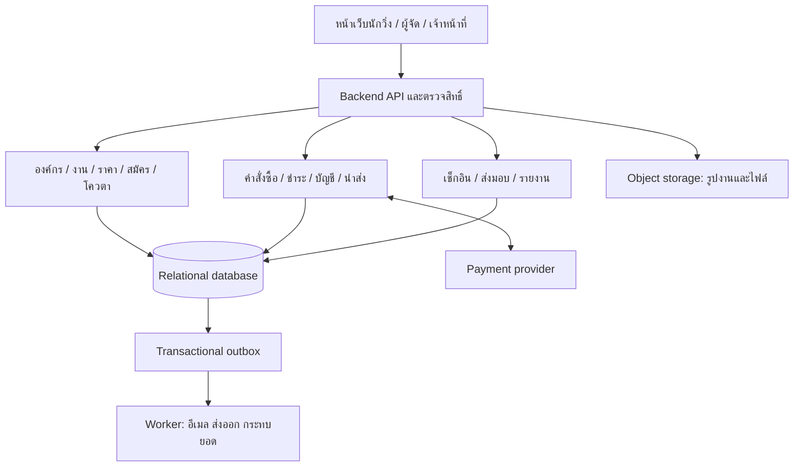

# Kratai — Product blueprint และขอบเขต MVP

วันที่: 14 พฤศจิกายน 2026
ปรับปรุงล่าสุด: 17 พฤศจิกายน 2026 — เพิ่มแผนสินค้าและบริการผลิตตามคำขอผู้ใช้ รายละเอียดการค้าและลำดับส่งมอบยังเป็นข้อเสนอ
สถานะ: ข้อเสนอสำหรับเริ่มออกแบบรายละเอียด ยังไม่ได้เริ่มพัฒนาระบบ

## 1. การตัดสินใจที่ยืนยันแล้ว

- เป็นแพลตฟอร์มกลางสำหรับหลายผู้จัดงาน (multi-tenant B2B2C)
- ขั้นแรกคือวางระบบและขอบเขต MVP ก่อนพัฒนา
- เพิ่มการวางแผนขายเสื้อ/เหรียญที่ระลึกและบริการผลิตสำหรับผู้จัด ผู้ร่วมงาน และลูกค้าทั่วไป โดยยังไม่เริ่มพัฒนา
- นำแนวคิดด้านการบริหารงานจาก RunSignup และประสบการณ์นักวิ่ง/บริการภาพถ่ายจาก ThaiRun มาปรับใช้ ไม่คัดลอกแบรนด์หรือหน้าจอ

สมมติฐานสำหรับข้อเสนอนี้: เริ่มตลาดประเทศไทย ภาษาไทย และสกุลเงินบาท รองรับชื่อภาษาอังกฤษและนักวิ่งต่างชาติได้ในโครงสร้างข้อมูล ทั้งหมดนี้ยังปรับได้

## 2. คุณค่าของผลิตภัณฑ์

ผู้จัดเปิดรับสมัคร ตรวจเงิน และส่งมอบสิทธิ์ให้นักวิ่งได้จากข้อมูลชุดเดียว นักวิ่งค้นหางาน สมัคร ติดตามสถานะ และรับบริการหลังงานได้ผ่านบัญชีของตน

ความแตกต่างของรุ่นแรก: สมัครบนมือถือได้สะดวก ราคาสุทธิชัดเจน ผู้จัดเห็นยอดที่ตรวจสอบได้ เจ้าหน้าที่รับ BIB ได้รวดเร็ว และแยกข้อมูลแต่ละผู้จัดอย่างถูกต้อง

| แนวคิดต้นทาง | สิ่งที่นำมาใช้ | ลำดับ |
|---|---|---|
| RunSignup: ผู้จัดตั้งค่างานเอง | ตัวช่วยสร้างงาน แบบร่าง พรีวิว ตรวจความพร้อม และเผยแพร่ | MVP |
| RunSignup: กฎราคาและจำนวนรับ | ราคาตามช่วงเวลา โควตารายประเภท และโควตารวม | MVP |
| RunSignup: ระบบวันแข่ง | เช็กอินและรับ BIB จากรายชื่อเดียวกับใบสมัคร | MVP |
| RunSignup: ผู้สมัครจัดการตนเอง | ดูใบสมัครและแก้เฉพาะช่องที่ผู้จัดเปิดให้แก้ก่อนเส้นตาย | MVP |
| ThaiRun: ศูนย์รวมงานวิ่ง | ค้นหางานตามวัน จังหวัด และระยะทาง | MVP |
| ThaiRun: ภาพหลังงาน | ลิงก์อัลบั้มที่ผู้จัดตรวจสอบแล้ว | MVP แบบเล็ก |
| ThaiRun: ตลาดภาพถ่าย | อัปโหลด ค้นหา ซื้อ และแบ่งรายได้ช่างภาพ | ระยะถัดไป |
| ทั้งสอง: ความสัมพันธ์ต่อเนื่อง | ประวัติงาน บันทึกงานที่สนใจ การสื่อสารและงานประจำปี | เริ่มประวัติใน MVP |

## 3. กลุ่มผู้ใช้และสิทธิ์

- นักวิ่ง: บัญชี ข้อมูลตนเอง ใบสมัคร การจ่ายเงิน หลักฐานรับอุปกรณ์
- เจ้าขององค์กรผู้จัด: สมาชิกทีม งานทุกงาน การตั้งค่าบัญชีรับเงิน และรายงานองค์กร
- ผู้จัดการงาน: ตั้งค่าและบริหารเฉพาะงานที่ได้รับมอบหมาย
- ฝ่ายการเงิน: ดูยอด ขอคืนเงิน และตรวจรายงานตามขอบเขตที่ได้รับ
- เจ้าหน้าที่เช็กอิน: ค้นหารายชื่อและบันทึกรับอุปกรณ์ของงานที่กำหนด ไม่เห็นข้อมูลการเงินหรือข้อมูลส่วนบุคคลที่ไม่จำเป็น
- ผู้ดูแลแพลตฟอร์ม: ตรวจผู้จัด อนุมัติเผยแพร่ ระงับงาน จัดการข้อร้องเรียน และตรวจประวัติ

คนหนึ่งสังกัดหลายองค์กรได้ สิทธิ์ผูกกับสมาชิกองค์กรและขอบเขตงาน ไม่ผูกกับบทบาทเดียวบนบัญชีผู้ใช้

## 4. ขอบเขต MVP

### นักวิ่ง

- สมัครบัญชีและเข้าสู่ระบบด้วยอีเมล/รหัสผ่าน, Google หรือ LINE พร้อมยืนยันอีเมล กู้รหัสผ่าน และเชื่อมบัญชี ดูข้อ 16 (ฟีเจอร์ที่ยืนยันให้เพิ่มในแผน ยังไม่ใช่ระบบจริง)
- ค้นหางาน ดูรายละเอียดเส้นทาง ระยะ ราคา สิ่งที่จะได้รับ วันรับอุปกรณ์ และเงื่อนไข
- สมัครหนึ่งคนต่อคำสั่งซื้อในรุ่นแรก เลือกระยะและเสื้อ กรอกข้อมูลที่จำเป็น ยอมรับกติกา
- เห็นยอดรวม ค่าบริการ และค่าใช้จ่ายอื่นก่อนจ่าย
- จ่ายผ่านผู้ให้บริการชำระเงินที่เลือก ดูสถานะ ใบยืนยัน และ QR รับอุปกรณ์
- ดูประวัติใบสมัคร และแก้ข้อมูลตามนโยบายงาน
- เข้าถึงผลการแข่งขันหรืออัลบั้มผ่านลิงก์ที่ผู้จัดประกาศ

### ผู้จัดงาน

- สมัครองค์กร เพิ่มทีม ส่งข้อมูลตรวจสอบผู้จัดและบัญชีรับเงิน
- สร้างงานแบบร่าง ตั้งวัน สถานที่ ระยะ โควตา ราคา เสื้อ และนโยบาย
- พรีวิว ส่งตรวจ และเปิดรับสมัครหลังผ่านเงื่อนไขความพร้อม
- ดูและส่งออกรายชื่อ แยกยอดชำระ ยอดรอดำเนินการ และยอดคืน
- กำหนดหรือ import BIB แบบตรวจเลขซ้ำในขอบเขตงาน
- ดูสรุปเสื้อแต่ละขนาดและบันทึกส่งมอบอุปกรณ์
- เช็กอินผ่านเว็บบนมือถือด้วย QR หรือค้นหาที่ควบคุมสิทธิ์
- ส่งอีเมลสำคัญ เช่น ยืนยันสมัคร แจ้งรายละเอียดวันงาน และแจ้งยกเลิก
- ขอคืนเงินพร้อมเหตุผลตามขั้นตอนที่กำหนด
- ดูรายการยอดนำส่งและรายการที่ยังตรวจสอบไม่จบ
- ส่วนขยายที่เสนอ: ร้านค้าของงาน โปรโมทสินค้า พรีออเดอร์ และขอราคาผลิตกับ Kratai ดูรายละเอียดข้อ 15; ยังต้องยืนยันการรวมใน MVP รุ่นแรก

### ผู้ดูแลแพลตฟอร์ม

- ตรวจองค์กรและการตั้งค่ารับเงินก่อนเปิดขาย
- ตรวจงานก่อนเผยแพร่ในช่วง MVP
- จัดการเรื่องร้องเรียนและข้อยกเว้น พร้อมประวัติผู้ดำเนินการ
- ตรวจธุรกรรม ยอดนำส่ง และการคืนเงิน
- ระงับงาน/องค์กรโดยไม่ลบหลักฐานการเงินและใบสมัครย้อนหลัง

### ยังไม่รวมใน MVP

- ตลาดขายภาพ ระบบค้นหาใบหน้า และแบ่งเงินช่างภาพ
- ระบบจับเวลาจากชิป GPS tracking และผลการแข่งขันสด
- Virtual Run และการเชื่อมอุปกรณ์สุขภาพ
- fundraising, สมาชิกชมรม, loyalty, referral และแคมเปญอีเมลขั้นสูง
- สมัครกลุ่ม relay ย้ายสิทธิ์ข้ามคน เลื่อนสิทธิ์ข้ามปี และ waitlist อัตโนมัติ
- แอป native, marketplace สินค้าทั่วไป และ AI chatbot
- marketplace สินค้าทั่วไปในที่นี้หมายถึงตลาดหลายร้านแบบเต็มรูปแบบ ไม่รวมข้อเสนอร้านค้าเฉพาะงานในข้อ 15 ซึ่งลูกค้าซื้อได้โดยไม่สมัครวิ่ง
- เช็กอินออฟไลน์อัตโนมัติ: รุ่นแรกใช้ระบบออนไลน์พร้อมรายชื่อสำรองและขั้นตอนกระทบยอด

## 5. Workflow

### เปิดงาน

สร้างองค์กร → ตรวจผู้จัด/บัญชีรับเงิน → สร้างงาน → ตั้งราคา/โควตา/นโยบาย → พรีวิว → ตรวจความพร้อม → อนุมัติเผยแพร่ → เปิดรับสมัคร

### สมัคร

เลือกงาน → ตรวจคุณสมบัติ → เลือกระยะ/เสื้อ → กรอกข้อมูล → ยอมรับนโยบายฉบับที่ใช้ → คำนวณยอดฝั่งเซิร์ฟเวอร์ → กันโควตาชั่วคราว → สร้างรายการชำระ → รับผลที่ตรวจสอบแล้ว → ยืนยันสิทธิ์ → ส่งใบยืนยัน

### วันงาน

เตรียม BIB/เสื้อ → สแกน QR → ตรวจสิทธิ์และรายการส่งมอบ → เจ้าหน้าที่กดยืนยันรับ → บันทึกผู้ทำรายการและเวลา → ป้องกันรับซ้ำ

### ปิดงาน

ประกาศผล/อัลบั้ม → แก้ข้อยกเว้น → กระทบยอดธุรกรรม/คืนเงิน/นำส่ง → ปิดรายงาน → ทำสำเนางานครั้งต่อไปโดยไม่คัดลอกข้อมูลส่วนบุคคลของผู้สมัครโดยอัตโนมัติ

## 6. กฎธุรกิจสำคัญ

1. Tenant isolation: ทุกคำขอของผู้จัดต้องตรวจสมาชิกองค์กรและสิทธิ์งานบนเซิร์ฟเวอร์ ไม่เชื่อ organization_id จากหน้าเว็บอย่างเดียว
2. การเผยแพร่: ต้องมีวัน สถานที่ ประเภท ราคา โควตา นโยบาย ช่องทางติดต่อ และบัญชีรับเงินพร้อมใช้งาน
3. เวลา: เก็บเวลามาตรฐานและ timezone ของงาน ใช้ Asia/Bangkok เป็นค่าเริ่มต้นตามสมมติฐานตลาดไทย
4. ราคา: เซิร์ฟเวอร์คำนวณและบันทึก snapshot ยอดรวม/ส่วนลด/ค่าบริการของคำสั่งซื้อ กำหนดให้ช่วงราคาไม่ซ้อนกัน
5. โควตา: กันประเภทวิ่ง โควตารวม และเสื้อแบบ atomic ไม่ขายเกินเมื่อมีคนสมัครพร้อมกัน อายุการกันต้องสัมพันธ์กับ payment provider
6. สมัครซ้ำ: ตรวจผู้เข้าร่วมเดียวกันในประเภทเดียวกันตามนโยบาย ไม่บังคับเก็บเลขบัตรประชาชนเพียงเพื่อใช้เป็น unique key
7. Payment: ไม่ถือว่าหน้ากลับจาก payment gateway คือหลักฐานจ่ายสำเร็จ ต้องตรวจ webhook หรือสอบถามสถานะจาก provider
8. Idempotency: webhook ซ้ำต้องไม่ยืนยันซ้ำ ตัดโควตาซ้ำ หรือสร้างรายการเงินซ้ำ
9. การจ่ายล่าช้า: ถ้าโควตาหมดอายุแล้วแต่รับเงินสำเร็จ ต้องพักรายการไว้ตรวจสอบ ยืนยันได้เมื่อจัดสรรโควตาใหม่สำเร็จ มิฉะนั้นเข้าสู่กระบวนการคืนเงิน ห้ามยืนยันจนเกินโควตา
10. คืนเงิน: ใช้สถานะแยกจากใบสมัครและการชำระ อนุญาตในขอบเขตวงเงินที่จ่ายจริง และบันทึกเหตุผล ไม่คืนโควตาอัตโนมัติโดยไม่มีนโยบาย
11. แก้ข้อมูล: ผู้จัดกำหนดช่องและเส้นตาย ค่าใช้จ่ายหรือโควตาที่เปลี่ยนต้องผ่าน workflow เฉพาะ ไม่แก้ยอดย้อนหลังทับของเดิม
12. เช็กอิน: QR เป็น token ที่คาดเดายาก ไม่ใส่ข้อมูลอ่อนไหว เจ้าหน้าที่ต้องล็อกอิน การสแกนเพียงอย่างเดียวยังไม่ถือว่าส่งมอบแล้ว
13. รับอุปกรณ์: แยก check-in จากการรับ BIB/เสื้อ เผื่อมารับก่อนวันแข่ง การยกเลิกการรับต้องมีสิทธิ์และเหตุผล
14. นโยบาย: บันทึกฉบับนโยบายที่ยอมรับ เวลา และผู้ดำเนินการ แยกการยินยอมการตลาดออกจากเงื่อนไขเข้าร่วม
15. รายงาน: ยอดสมัคร ยอดรับเงิน รายได้แพลตฟอร์ม และยอดนำส่งผู้จัดเป็นคนละค่า ต้องติดตามได้ระดับรายการ

## 7. สถานะและแบบจำลองข้อมูล

สถานะไม่ควรรวมไว้ใน field เดียว:

- Event: draft → in_review → published → closed → completed; มี suspended/cancelled เป็นทางแยก
- Registration: pending_payment → confirmed → cancelled; expired สำหรับรายการที่ไม่ได้สิทธิ์
- Payment: pending → succeeded / failed / expired; ติดตาม refunded amount แยก
- Refund: requested → approved → processing → succeeded / failed / rejected
- Payout: scheduled → processing → paid / failed / held
- CheckIn และ Fulfillment: เป็นรายการเหตุการณ์ที่ตรวจการรับซ้ำและตรวจย้อนกลับได้

Entity หลัก:

| กลุ่ม | Entity |
|---|---|
| ตัวตนและองค์กร | User, Organization, OrganizationMembership, EventPermission |
| งานและสินค้า | Event, RaceCategory, PriceTier, InventoryOption, PolicyVersion |
| สมัคร | ParticipantProfile, Registration, InventoryReservation, PolicyAcceptance |
| เงิน | Order, OrderLine, PaymentAttempt, ProviderEvent, Refund, LedgerEntry, Payout |
| ปฏิบัติการ | BibAssignment, CheckIn, Fulfillment, Notification, AuditLog |

ผู้ซื้อกับผู้เข้าร่วมแยกแนวคิดตั้งแต่แรก แม้ UI รุ่นแรกสมัครทีละคน เพื่อไม่ต้องรื้อข้อมูลเมื่อต้องรองรับผู้ปกครองหรือสมัครกลุ่มภายหลัง

## 8. Architecture ที่เสนอ

เริ่มด้วย modular monolith: แอปหลักแยกโมดูลชัดเจน ใช้ฐานข้อมูลเชิงสัมพันธ์ร่วมกัน และมี background worker สำหรับงานเบื้องหลัง ไม่จำเป็นต้องเริ่มด้วย microservices

- ใช้ transaction และ constraints คุมโควตา BIB และรายการเงิน
- ใช้ outbox/คิวส่งอีเมลหลังยืนยันธุรกรรมสำเร็จ ป้องกันส่งแจ้งเตือนสำหรับธุรกรรมที่ rollback
- เก็บยอดเงินเป็นหน่วยย่อยจำนวนเต็มและระบุสกุลเงิน
- เก็บบัญชีรายการเงินแบบตรวจย้อนหลังได้ ไม่คำนวณยอดนำส่งจากยอดใบสมัครปัจจุบันเพียงอย่างเดียว
- แยกข้อมูลธุรกรรมออกจาก analytics; analytics ใช้สรุปแนวโน้ม ไม่ใช้ตัดสินว่าใครจ่ายแล้ว
- กำหนด retention, export ที่จำกัดสิทธิ์, signed download links และการเข้าถึงข้อมูลฉุกเฉิน
- มี structured logs, error monitoring, backup และทดสอบกู้คืน
- ยังไม่ล็อก framework, cloud หรือ payment provider จนกว่าจะทราบข้อจำกัดทีมและการรับเงิน

## 9. เงินและโมเดลธุรกิจ

ข้อเสนอเริ่มต้น: ค่าบริการตามการสมัครที่ชำระสำเร็จ โดยเลือกให้นักวิ่งหรือผู้จัดเป็นผู้รับภาระได้ แสดงยอดชัดเจนก่อนชำระ ยังไม่กำหนดอัตราเพราะต้องรู้ต้นทุน provider, support และความเสี่ยงคืนเงินก่อน

แยกยอด:

- มูลค่าธุรกรรมรวม: เงินที่ขายได้ผ่านระบบ ไม่ใช่รายได้บริษัท
- รายได้แพลตฟอร์ม: ค่าบริการที่มีสิทธิ์รับตามสัญญา
- เงินผู้จัด: ภาระที่ต้องนำส่งหลังหักรายการตามข้อตกลง
- ต้นทุน: gateway, hosting, support และรายการที่ต้องรับภาระจริง

ควรตรวจความพร้อมของ provider สำหรับ marketplace/sub-merchant ก่อนกำหนดรูปแบบรับและนำส่งเงิน ไม่สมมติว่าระบบจะรับเงินทั้งหมดเข้าบัญชีแพลตฟอร์มแล้วโอนต่อได้ทันที ขอบเขตภาษี เอกสารบัญชี และสัญญาต้องตกลงกับผู้ให้บริการและผู้เชี่ยวชาญก่อนเปิดขายจริง

## 10. Acceptance criteria ก่อน pilot

- องค์กร A ไม่สามารถอ่าน แก้ ส่งออก หรือเช็กอินข้อมูลขององค์กร B ได้
- เปิดรับสมัครได้ครบวงจรตั้งแต่ draft ถึงยืนยันสิทธิ์และส่งอีเมล
- ทดสอบแย่งโควตาสุดท้ายพร้อมกันแล้วไม่ขายเกิน รวมโควตาเสื้อ
- webhook ซ้ำ ผิดลำดับ จ่ายหลังหมดเวลา และ network timeout ไม่สร้างสิทธิ์หรือยอดซ้ำ
- คำสั่งซื้อแต่ละรายการตามกลับไปยัง payment, refund และ payout ได้
- เช็กอินซ้ำจากสองอุปกรณ์ต้องมีผู้ยืนยันสำเร็จได้เพียงครั้งเดียว
- ส่งออกยอดเสื้อ BIB และผู้มีสิทธิ์ตรงกับข้อมูลจริง
- บทบาทการเงินและเช็กอินเข้าถึงเฉพาะข้อมูลที่ต้องใช้
- ทดสอบ restore backup และขั้นตอนทำงานเมื่อบริการชำระเงินหรืออีเมลขัดข้อง
- ทดสอบบนมือถือกับผู้จัดและนักวิ่งจริงก่อนเปิด pilot

## 11. ลำดับส่งมอบ

1. ยืนยันนโยบายเงิน นโยบายสมัคร ขอบเขตผู้เข้าร่วม และเกณฑ์ pilot
2. ออกแบบ user journey, wireframe และต้นแบบสำหรับ flow หลัก
3. วาง schema, permission matrix, API contract และ state transitions
4. พัฒนา vertical slice: ผู้จัดสร้างงาน → นักวิ่งจ่ายใน sandbox → ยืนยัน → เช็กอิน
5. เติมรายงาน เงินคืน การนำส่ง การส่งออก และการดูแลระบบ
6. ทดสอบความถูกต้องและโหลดตามขนาด pilot ที่ตกลง แล้วทดลองกับผู้จัดกลุ่มเล็ก

ไม่กำหนดวันส่งมอบจนกว่าจะทราบทีม งบ ขนาดงาน และ provider

## 12. เรื่องที่ต้องตัดสินใจก่อนพัฒนา

- ไทย/THB เป็นตลาดแรกตามสมมติฐานหรือไม่
- ขนาด pilot: จำนวนผู้จัด จำนวนผู้สมัครต่ออีเวนต์ และการเปิดขายพร้อมกัน
- ผู้รับเงินตามสัญญา ผู้รับภาระค่าบริการ รอบนำส่ง และการคืนเงิน
- ผู้ให้บริการชำระเงินและช่องทางที่ต้องรองรับจริง
- นโยบายผู้เยาว์ สมัครแทน และข้อมูลจำเป็น เช่น เสื้อหรือผู้ติดต่อฉุกเฉิน
- ผู้รับผิดชอบ support ก่อนงานและวันงาน
- ทีมพัฒนา งบประมาณ โฮสติ้ง และข้อจำกัดเทคโนโลยี

## 13. ตัวชี้วัด

- เวลาที่ผู้จัดใช้จนเปิดรับสมัครสำเร็จ
- อัตราเริ่มสมัครจนได้สิทธิ์ และอัตราจ่ายสำเร็จ
- ความคลาดเคลื่อนของเงิน โควตา และรายการส่งมอบ
- เวลาต่อการเช็กอิน และจำนวนคำขอช่วยเหลือต่อ 100 ใบสมัคร
- รายได้ค่าบริการสุทธิหลังต้นทุนผันแปร
- จำนวนผู้จัดที่กลับมาเปิดงาน และนักวิ่งที่กลับมาสมัคร

## 14. แหล่งอ้างอิงและขอบเขตข้อสรุป

รายละเอียดฟีเจอร์บัญชีที่เพิ่มภายหลังอยู่ในข้อ 16 พร้อมแหล่งอ้างอิงเฉพาะด้าน

ข้อมูลคู่แข่งจากการศึกษาวันที่ 14 พฤศจิกายน 2026 ส่วนขอบเขตและ architecture ในเอกสารนี้เป็นข้อเสนอของ Kratai ไม่ใช่ระบบภายในของคู่แข่ง

- RunSignup products: https://info.runsignup.com/
- Registration: https://info.runsignup.com/products/race-registration/
- Pricing: https://info.runsignup.com/pricing/
- Strategy: https://info.runsignup.com/2025/10/29/2026-company-strategy/
- Infrastructure: https://info.runsignup.com/2025/11/28/2025-thanksgiving-and-year-infrastructure-report/
- ThaiRun products: https://www.thai.run/
- ThaiRun photo business explanation (2023; ไม่ใช่อัตราปัจจุบันที่ยืนยันแล้ว): https://read.thai.run/139/

## 15. สินค้า การโปรโมท และบริการผลิต

เพิ่มวันที่ 17 พฤศจิกายน 2026 ตามคำขอให้บันทึกแนวคิดลงแผน โครงสร้างด้านล่างเป็นข้อเสนอ ไม่ได้ยืนยันราคา จำนวนขั้นต่ำ ผู้ผลิต หรือสัญญาบริการ และไม่เปลี่ยนคำสั่งให้วางแผนก่อนลงโค้ด

### 15.1 ลูกค้าและจุดเชื่อมกับงานวิ่ง

| กลุ่ม | จุดใช้งาน | บริการ |
|---|---|---|
| ผู้จัดงาน | เตรียมงานและสรุปยอดก่อนผลิต | ซื้อจำนวนมาก ขอออกแบบ ผลิตเสื้อ/เหรียญ และติดตามส่งมอบ |
| ผู้สมัครงาน | ก่อนสรุปยอดสมัคร | ซื้อสินค้าเพิ่มจากแพ็กเกจสมัคร |
| ผู้สมัครเดิม | ใบสมัครของฉัน | สร้างคำสั่งซื้อสินค้าใหม่ เชื่อมใบสมัครเดิม |
| ลูกค้าทั่วไป | หน้าร้านของงาน | ซื้อสินค้าพร้อมขายหรือพรีออเดอร์โดยไม่ต้องสมัครวิ่ง |
| ชมรม ทีม บริษัท | หน้าบริการสั่งทำ | ส่งแบบ/ความต้องการ ขอราคา และติดตามการผลิต ไม่จำเป็นต้องมีงานวิ่ง |

### 15.2 รูปแบบบริการสำหรับผู้จัด

1. **นำสินค้ามาขายเอง:** ผู้จัดมีสินค้าและส่งมอบเอง Kratai ให้หน้าร้าน การโปรโมท คำสั่งซื้อ และรายงาน
2. **ให้ Kratai ผลิต:** ผู้จัดส่งแบบหรือขอช่วยออกแบบ รับใบเสนอราคา อนุมัติตัวอย่าง และรับสินค้าจำนวนมาก
3. **ให้ Kratai ดูแลครบ:** รวมเปิดพรีออเดอร์ ผลิต แพ็ก และจัดส่งถึงผู้ซื้อหรือเตรียมรับหน้างาน ตามข้อตกลง

ต้องระบุผู้ขาย ผู้รับเงิน ผู้ผลิต และผู้รับผิดชอบส่งมอบให้ชัดในแต่ละรายการ ไม่ถือว่า Kratai เป็นผู้ขายหรือผู้ผลิตในทุกกรณีโดยอัตโนมัติ ผู้จัดยังเลือกนำสินค้าที่ผลิตเองมาขายได้

### 15.3 การโปรโมทและเปลี่ยนความสนใจเป็นคำสั่งผลิต

- หน้าร้านเฉพาะงาน พร้อมภาพ รายละเอียด ตารางไซซ์ สถานะสินค้า และลิงก์แชร์
- เชื่อมสินค้าในหน้างาน ขั้นตอนสมัคร และใบสมัครเดิม โดยไม่บังคับซื้อเพิ่ม
- ตอนสร้างงานให้เลือกขอความช่วยเหลือเรื่องเสื้อ/เหรียญ
- ตอนเพิ่มสินค้าให้เลือกใช้สินค้าของตนหรือขอราคาผลิตกับ Kratai
- รายงานสรุปไซซ์และยอดต้องใช้ มีทางสร้างคำขอราคาจากยอดนั้น
- แจ้งเตือนวันปิดพรีออเดอร์ ส่งแบบ ยืนยันจำนวน และกำหนดรับสินค้า
- งานปีถัดไปนำแบบและข้อมูลยอดรวมมาช่วยประมาณการได้ โดยไม่คัดลอกข้อมูลส่วนบุคคลโดยไม่จำเป็น
- ข้อเสนอเชิงพาณิชย์ที่ต้องคำนวณก่อนใช้: ราคาตามจำนวน บริการตัวอย่าง/ช่วยออกแบบ สิทธิประโยชน์ค่าหน้าร้านหรือค่าบริการเมื่อสั่งผลิต
- ไม่สัญญายอดขาย การเข้าถึง ระยะผลิต หรือส่วนลดที่ยังไม่ได้รับการยืนยันจากต้นทุนและผู้ผลิต

### 15.4 Workflow

**ผู้จัดสั่งผลิต:** ประมาณการจำนวน → ส่งความต้องการ/แบบ → ขอราคา → ตรวจตัวอย่างและอนุมัติแบบ/ราคา → ยืนยันจำนวนและไซซ์ → ชำระตามข้อตกลง → ผลิต → ตรวจคุณภาพ → จัดส่ง → ตรวจรับ/แจ้งปัญหา

**ซื้อพร้อมสมัคร:** เลือกระยะ → เลือกสิทธิ์ที่รวมในแพ็กเกจ → เลือกซื้อเพิ่ม → รับหน้างาน/จัดส่ง → แสดงราคาแยกรายการ → ชำระ → ยืนยันใบสมัครและรายการสินค้าตามผลธุรกรรม

**ซื้อภายหลังหรือซื้อทั่วไป:** เปิดร้าน/ใบสมัคร → เลือกสินค้าและไซซ์ → เลือกส่งมอบ → สร้างคำสั่งซื้อใหม่ → ชำระ → ติดตามสินค้า โดยการซื้อทั่วไปไม่สร้างสิทธิ์เข้าร่วมการแข่งขัน

**พรีออเดอร์:** ประกาศเงื่อนไขและวันปิด → รวบรวมคำสั่งซื้อ → ตรวจยอดตามฐานที่ระบุ → สรุปยอดผลิต → อนุมัติผลิต → ส่งมอบ หากไม่ถึงขั้นต่ำให้ใช้ทางเลือกที่ประกาศ เช่น ยกเลิกและคืนเงิน ไม่ถือว่าคำสั่งซื้อรับประกันว่าจะเริ่มผลิตทันที

### 15.5 กฎสินค้าและสิทธิ์

- เสื้อรวมค่าสมัครเป็นสิทธิ์แพ็กเกจ เสื้อซื้อเพิ่มเป็นรายการขาย มีราคาและจำนวนแยกกัน
- เหรียญ Finisher ผูกกับกติกาจบการแข่งขัน เหรียญที่ระลึกเป็นสินค้า รางวัลผู้ชนะผูกกับผล/อันดับ การซื้อไม่ทำให้ได้สถานะ Finisher หรือผู้ชนะ
- สินค้าต้องแยก SKU/variant เช่น แบบ สี ไซซ์ วัสดุ พร้อมสต็อกหรือเพดานพรีออเดอร์ การใช้สินค้าร่วมกันระหว่างแพ็กเกจกับร้านต้องจัดสรรจากแหล่งเดียวกันเพื่อไม่ขายเกิน
- ยอดต้องผลิตต้องแยกของตามสิทธิ์ สินค้าซื้อเพิ่ม และจำนวนสำรองที่ผู้จัดกำหนด หักสินค้าที่มีและรายการจัดซื้อเดิมอย่างมีหลักฐาน ไม่รวมซ้ำหรือเดาจำนวนสำรอง
- เก็บยอดและเวอร์ชันแบบ ณ วันอนุมัติผลิต การเปลี่ยนหลังอนุมัติต้องแจ้งผลต่อราคา/เวลาและบันทึกการยอมรับใหม่
- หน้าสินค้าแสดงผู้ขาย ราคา ไซซ์ พร้อมส่ง/พรีออเดอร์ ขั้นต่ำถ้ามี วันปิด วันที่คาดส่ง ค่าส่ง และเงื่อนไขกรณียอดไม่ถึง/คืน/เปลี่ยน/ชำรุด
- รายการซื้อหลังสมัครเป็นคำสั่งซื้อใหม่ การคืนสินค้าไม่ยกเลิกสิทธิ์สมัครโดยอัตโนมัติ และการยกเลิกงานไม่คืนสินค้าทุกรายการโดยอัตโนมัติ ต้องกำหนดนโยบายแยก
- เงินค่าสมัคร ค่าขายสินค้า ค่าบริการ ค่าส่ง และเงินจัดซื้อ/ผลิตแยกรายการให้กระทบยอดได้ หากมีมัดจำให้ติดตามยอดครบกำหนดและยอดคงเหลือแยกจากสถานะผลิต
- รุ่นแรกเสนอให้หนึ่งคำสั่งซื้อสินค้ามีผู้ขายหนึ่งราย ไม่เริ่มตะกร้าหลายผู้ขายจนกว่ากติกานำส่ง/คืนเงินชัด
- การส่งมอบติดตามระดับรายการและจำนวน รองรับแยกส่งหรือรับบางส่วน ป้องกันส่ง/รับซ้ำ ไม่ใช้ check-in คนเดียวแทนการรับสินค้าทั้งหมด
- การรับสินค้าโดยผู้ไม่สมัครวิ่งใช้หลักฐานคำสั่งซื้อ ไม่ต้องมี BIB และไม่ทำให้เกิด race check-in
- คำขอผลิตไม่ใช่คำสั่งให้โรงงานเริ่มงาน จนกว่าจะผ่านการยืนยันแบบ ราคา จำนวน และเงื่อนไขชำระที่ตกลง
- ผู้จัด/ผู้สั่งทำยืนยันสิทธิ์ใช้แบบหรือโลโก้ก่อนเผยแพร่และผลิต กำหนดขอบเขตเข้าถึงไฟล์แบบและข้อมูลจัดส่งตามบทบาท

### 15.6 ข้อมูลและสถานะที่เสนอเพิ่ม

| กลุ่ม | แนวคิดข้อมูล |
|---|---|
| ร้านค้า | Storefront, Product, ProductVariant, Seller |
| สินค้าคงคลัง | StockMovement, StockReservation, PreorderCampaign |
| สั่งทำ | ProductionInquiry, Quote, ArtworkVersion, ArtworkApproval, ProductionOrder |
| ส่งมอบ | Shipment, FulfillmentLine, GoodsReceipt |

ใช้ Order/OrderLine, Payment, Refund และ Ledger เดิมร่วมเมื่อเหมาะสม โดยแยกประเภทและคู่สัญญา ไม่สร้างชุดยอดเงินที่ขัดกัน สถานะชำระ ผลิต และส่งมอบแยกจากกัน

- คำขอราคา: ร่าง → ส่งคำขอ → รอข้อมูล/เสนอราคา → ยอมรับ/ปฏิเสธ/หมดอายุ
- งานผลิต: รอยืนยันเงื่อนไข → พร้อมผลิต → ผลิต → ตรวจคุณภาพ → พร้อมส่ง → ปิดงาน; มีทางพัก/แก้ไข/ยกเลิกตามเงื่อนไข
- สินค้าส่งมอบ: ยังไม่จัดสรร → เตรียมของ → พร้อมรับ/ส่งแล้ว → รับบางส่วน/ครบ → ปัญหา/ส่งคืน

### 15.7 ลำดับที่เสนอและเรื่องต้องตัดสินใจ

เริ่มจากร้านค้าเฉพาะงาน ลิงก์โปรโมท สินค้าพร้อมขาย/พรีออเดอร์ ซื้อเพิ่ม และแบบฟอร์มขอราคาผลิต โดยทีม Kratai ประสานใบเสนอราคาและโรงงานหลังบ้านก่อน ยังไม่ทำ marketplace ผู้ผลิตหรือระบบโรงงานอัตโนมัติ

ต้องยืนยันก่อนรวมในรุ่นส่งมอบ: ผู้ขายและผู้รับเงินแต่ละโมเดล ต้นทุน/ค่าบริการ ผู้ผลิตและขั้นต่ำ รอบชำระ ระยะผลิต ตัวอย่าง/อนุมัติแบบ การส่งมอบ ภาษี/เอกสารตามผู้ขาย และนโยบายคืน/ยกเลิก/ชำรุด

ตัวชี้วัดที่เสนอ: ผู้จัดที่เปิดร้านและขอราคา อัตรายอมรับใบเสนอราคา ยอดสั่งผลิต มูลค่าขายสินค้า กำไรหลังต้นทุนผันแปร การส่งตรงเวลา และอัตราปัญหาสินค้า ทุกตัวต้องนิยามฐานเวลาและแยกยอดขายออกจากรายได้แพลตฟอร์ม

## 16. บัญชีและการเข้าสู่ระบบ (Complete Registration & Authentication System)

เพิ่มและขยายความวันที่ 17 พฤศจิกายน 2026 และ **พัฒนาลงต้นแบบ Interactive Local Mockup เมื่อ 18 พฤศจิกายน 2026** (`src/components/AuthViews.tsx`, `src/components/PlatformAdminView.tsx`, `src/App.tsx`): รองรับระบบลงทะเบียนและเข้าสู่ระบบแบบครบวงจรสำหรับ **Runner (นักวิ่ง/ผู้ใช้ทั่วไป)** และ **Organizer (ผู้จัดงาน)** ภายใต้ Design System เดียวกัน แต่แยกฟอร์ม กฎตรวจสอบ ขั้นตอน Onboarding สิทธิ์การใช้งาน และ Dashboard ออกจากกันอย่างชัดเจน ทั้งนี้ระบบในต้นแบบปัจจุบันยังเป็นการจำลองฝั่งหน้าบ้านใน `localStorage` เท่านั้น (ยังไม่เชื่อม OAuth Provider จริงหรือเซิร์ฟเวอร์จริง)

### 16.1 เป้าหมายและหน้าเลือกประเภทบัญชี (Account Type Selection)

- รองรับ 2 ประเภทบัญชีหลักในสถาปัตยกรรม SaaS ที่ขยายตัวได้:
  1. **Runner:** ผู้ใช้ทั่วไปที่ค้นหางานวิ่ง สมัครแข่งขัน และจัดการกิจกรรมวิ่งของตนเอง
  2. **Organizer:** องค์กรหรือบุคคลที่สร้าง เผยแพร่ และบริหารงานวิ่ง
- **หน้าทางเข้าเลือกประเภทบัญชี (Entry Point):**
  - หัวข้อหลัก: `"Join the Running Community"`
  - คำอธิบาย: `"Choose how you want to use the platform."` (รองรับการแสดงผลภาษาไทยควบคู่ตามบริบทแพลตฟอร์ม)
  - แสดงการ์ดเลือกขนาดใหญ่ 2 ใบ:
    - **Runner Card:** ไอคอน Runner/User · ชื่อ `Runner` · คำอธิบาย `Discover running events, register for races, and manage your running activities.` · ปุ่ม CTA `Register as Runner`
    - **Organizer Card:** ไอคอน Building/Event · ชื่อ `Organizer` · คำอธิบาย `Create running events, manage registrations, and monitor event performance.` · ปุ่ม CTA `Register as Organizer`
- ผู้ใช้สลับประเภทการลงทะเบียนหรือเพิ่มบทบาทภายหลังได้โดยไม่สูญเสียข้อมูลบัญชีเดิมที่มีอยู่แล้ว

### 16.2 ระบบยืนยันตัวตนร่วมและบัญชีเดียวหลายบทบาท (Shared Authentication & Account Linking)

- รองรับวิธีเข้าสู่ระบบและสมัครใช้งาน: **Google Login**, **LINE Login**, **Email Registration** และ **Email Login** (ใช้มาตรฐาน OAuth 2.0 / OpenID Connect)
- หน้าเข้าสู่ระบบมีอีเมล/รหัสผ่าน ปุ่มแสดงหรือซ่อนรหัสผ่าน ลืมรหัสผ่าน สมัครใหม่ และปุ่ม Google/LINE
- แยกข้อมูลผู้ให้บริการยืนยันตัวตน (`AuthIdentity` / `user_auth_providers` เช่น `issuer + sub`) ออกจากข้อมูลโปรไฟล์ผู้ใช้ (`UserProfile`) ไม่ใช้อีเมลหรือชื่อแสดงผลจาก social เป็นคีย์หลักแทนตัวระบุ provider
- **การเชื่อมบัญชีและป้องกันบัญชีซ้ำ:**
  - บัญชีผู้ใช้ (`User`) หนึ่งรายการถือได้หลายบทบาทเมื่อกฎธุรกิจอนุญาต และเชื่อมวิธีเข้าสู่ระบบได้หลายช่องทาง
  - ผู้ใช้ที่ Login อยู่เชื่อม Google/LINE เพิ่มได้หลังยืนยันตัวตนซ้ำ; ผู้สมัครผ่าน social เพิ่มอีเมลที่ยืนยันแล้วและตั้งรหัสผ่านเพิ่มเติมได้
  - ป้องกันบัญชีซ้ำเมื่ออีเมลที่ยืนยันแล้วตรงกับบัญชีเดิม โดยบังคับผ่านขั้นตอนยืนยันความเป็นเจ้าของบัญชีเดิมก่อนเชื่อม (**ห้ามรวมบัญชีอัตโนมัติเงียบ ๆ**)
  - หาก provider identity ผูกกับบัญชีอื่นอยู่แล้ว ต้องหยุดการเชื่อมและเข้าสู่ขั้นตอนพิสูจน์ตัวตนทั้งสองฝั่ง ห้ามย้ายประวัติ เงิน หรือสิทธิ์องค์กรโดยอัตโนมัติ
  - ห้ามถอดช่องทางเข้าสู่ระบบช่องทางสุดท้ายจนกว่าจะเพิ่มและยืนยันช่องทางทดแทนแล้ว
- **กรณี LINE ไม่มีอีเมล:** สร้างบัญชีจากตัวตน LINE ที่ตรวจสอบแล้วได้โดยไม่สร้างอีเมลสมมติแทน และขอให้เพิ่ม/ยืนยันอีเมลติดต่อเมื่อใช้ฟังก์ชันที่ต้องใช้อีเมล
- **ขอบเขตอำนาจองค์กร:** ห้ามถือว่าการผ่าน Google หรือ LINE Login เป็นการยืนยันสิทธิ์หรืออำนาจตัวแทนองค์กรผู้จัด สิทธิ์ผู้จัดต้องมาจาก `OrganizationMembership` และการตรวจสอบองค์กรเท่านั้น
- คำเชิญทีมมีบทบาท ขอบเขต อายุ และการใช้ครั้งเดียว ตรวจบัญชีผู้รับตามนโยบายก่อนเพิ่มสมาชิก ไม่อาศัยการมีลิงก์อย่างเดียวเพื่อให้สิทธิ์สำคัญ
- อ่านรายละเอียดงานและดูสินค้าได้ก่อน Login เมื่อยืนยันตัวตนสำเร็จให้พากลับไปยังรายการที่ทำค้าง (`ReturnIntent` เฉพาะปลายทางภายในที่อนุญาต ป้องกัน open redirect)

### 16.3 Runner Registration Flow (Wizard 2 ขั้นตอน — เร็วและกระชับ)

ออกแบบให้สมัครง่ายและเร็ว แยกเป็น 2 ขั้นตอน:

- **Step 1 — Account Registration:**
  - ฟิลด์: `First Name` (บังคับ), `Last Name` (บังคับ), `Email Address` (บังคับ), `Phone Number` (บังคับหรือไม่บังคับตามนโยบายแพลตฟอร์ม), และกรณีสมัครด้วยอีเมลต้องมี `Password` + `Confirm Password` พร้อมแถบวัดความแข็งแรงของรหัสผ่าน (`Password strength indicator`)
  - ปุ่ม Social: `Continue with Google` และ `Continue with LINE`
  - ดึงข้อมูลโปรไฟล์ที่ได้จาก provider มาเติมให้อัตโนมัติโดยผู้ใช้แก้ไขได้ ตรวจรูปแบบอีเมลและเบอร์โทรพร้อมแสดง Inline validation errors ชัดเจน
- **Step 2 — Runner Profile (ข้ามฟิลด์ไม่บังคับได้):**
  - ข้อมูลทั่วไป: `Profile Picture` (ไม่บังคับ), `Date of Birth` (ไม่บังคับ), `Gender` (ไม่บังคับ), `Nationality` (ค่าเริ่มต้น `Thailand`), `Running Experience` (`Beginner` / `Intermediate` / `Advanced`)
  - ผู้ติดต่อฉุกเฉินเริ่มต้น (`Emergency Contact`): `Name`, `Relationship`, `Phone`
  - ความสนใจระยะวิ่ง (`Preferred Running Distance` — ไม่บังคับ): `3 KM`, `5 KM`, `10 KM`, `Half Marathon (21.1 KM)`, `Marathon (42.195 KM)`, `Other`
  - **กฎธุรกิจสำคัญของ Runner Onboarding:**
    - ไม่บังคับกรอกทุกช่องในโปรไฟล์เพื่อจบการสร้างบัญชี ผู้ใช้กดข้ามฟิลด์ไม่บังคับไปเติมภายหลังได้
    - **ห้ามบังคับเลือกไซส์เสื้อ (`T-shirt size`) และห้ามบังคับเลือกระยะแข่งขันจริงระหว่างสมัครบัญชีผู้ใช้**
    - ข้อมูลทางการแพทย์ต้องไม่บังคับ (`optional`) เก็บเฉพาะเมื่อจำเป็นต่อวัตถุประสงค์ของแต่ละงานพร้อมมาตรการคุ้มครองข้อมูลส่วนบุคคล
- **Runner Registration Completion:**
  - แสดงหน้าต้อนรับพร้อมชื่อผู้ใช้ ตัววัดความสมบูรณ์ของโปรไฟล์ (`Profile Completion Indicator`) ปุ่ม CTA ไปค้นหางานวิ่ง และนำทางเข้าสู่ **Runner Dashboard**

### 16.4 Organizer Registration Flow (Wizard 3 ขั้นตอน + บันทึกแบบร่าง + ตรวจสอบเอกสาร)

การลงทะเบียนผู้จัดงานต้องเก็บข้อมูลองค์กรและหลักฐานยืนยันตัวตน แยกเป็น 3 ขั้นตอน พร้อมรองรับการบันทึกแบบร่าง (`Save Draft`):

- **Step 1 — Account & Contact Information:**
  - ฟิลด์: `First Name`, `Last Name`, `Email`, `Phone Number`, `Position / Job Title`
  - รองรับ `Google Login`, `LINE Login` และ `Email Registration` (`Password`, `Confirm Password`, `Password strength indicator`)
- **Step 2 — Organization Details:**
  - *Section A — Organization Profile:* `Organization Name (Thai)` (บังคับ), `Organization Name (English)` (ไม่บังคับ), `Organization Type` (บังคับ: `Private Company`, `Government Organization`, `Sports Club / Association`, `Independent Organizer`, `Non-Profit Organization`, `Other`), `Business Registration Number` (บังคับตามเงื่อนไขประเภทองค์กร), `Website`, `Organization Email`, `Organization Phone`, `Organization Logo`
  - *Section B — Office Address:* `Address`, `Province`, `District`, `Subdistrict`, `Postal Code`, `Country` (ใช้ Dropdown จังหวัด-อำเภอ-ตำบล-รหัสไปรษณีย์ของไทยแบบเชื่อมโยงกันเมื่อมีชุดข้อมูลมาตรฐานที่ถูกต้อง)
  - *Section C — Organization Description:* `Organization Description`, `Previous Running Events`, `Facebook Page`, `Other Social Media Links`
  - *Section D — Main Contact Person:* `Contact Person Name`, `Position`, `Contact Phone`, `Contact Email` พร้อมตัวเลือก `"Same as account contact"`
- **Step 3 — Identity & Organization Verification:**
  - *Section A — Verification Type:* `Company / Legal Entity`, `Government Organization`, `Sports Club / Association`, `Independent Organizer`, `Non-Profit Organization`
  - *Section B — Personal Identity Verification (เก็บเฉพาะเมื่อนโยบายตรวจสอบกำหนด):* `Identity Document Type`, `Identity Document File`, `Document Expiry Date` (ถ้ามี)
  - *Section C — Organization Verification Documents:* รองรับหนังสือรับรองนิติบุคคล (`Company Registration Certificate`), หนังสืออนุญาตหน่วยงานรัฐ (`Government Authorization Document`), เอกสารจดทะเบียนชมรม/สมาคม (`Club / Association Registration Document`), เอกสารองค์กรไม่แสวงหากำไร (`Non-Profit Organization Certificate`) และเอกสารประกอบอื่น (`Other Supporting Documents`)
  - *Section D — Authorization Documents (แสดงตามเงื่อนไขเมื่อผู้ยื่นไม่ใช่ผู้มีอำนาจลงนามโดยตรงหรือเมื่อนโยบายกำหนด):* หนังสือมอบอำนาจ (`Power of Attorney`), หนังสือแต่งตั้งตัวแทน (`Representative Appointment Letter`) หรือหนังสือรับรองการดำเนินการ (`Authorization Letter`)
  - *Section E — Consent:* ยืนยันว่าข้อมูลที่ยื่นถูกต้อง ยอมรับกระบวนการตรวจสอบผู้จัด รับทราบประกาศความเป็นส่วนตัว (`Privacy Notice`) และแยกความยินยอมรับข่าวสารการตลาด (`Optional Marketing Consent`) ออกจากความยินยอมหลักพร้อมบันทึกเวอร์ชัน
- **ข้อกำหนดการอัปโหลดเอกสารยืนยันตัวตน:**
  - รองรับไฟล์ `PDF, JPG, JPEG, PNG` แสดงขนาดไฟล์สูงสุดที่รับได้ ชื่อไฟล์ ขนาดไฟล์จริง แถบความคืบหน้าอัปโหลด (`Upload progress`) พรีวิวไฟล์ (กรณีรองรับ) และการเปลี่ยน/ลบไฟล์
  - ตรวจสอบทั้งนามสกุลไฟล์และชนิดไฟล์จริง (`MIME type` ฝั่งเซิร์ฟเวอร์)
  - จัดเก็บในพื้นที่ส่วนตัว (`Private Storage`) **ห้ามเปิดเผยเอกสารยืนยันตัวตนผ่าน Public URL โดยเด็ดขาด**
- **Organizer Registration Completion:**
  - แสดงหน้าส่งคำขอสำเร็จ ระบุชื่อองค์กร หมายเลขอ้างอิงคำขอ (`Registration Reference Number`) วันที่ส่ง สถานะเริ่มต้น (`SUBMITTED` หรือ `PENDING_REVIEW`) และอธิบายขั้นตอนการรอตรวจสอบถัดไป (**ห้ามอนุมัติผู้จัดโดยอัตโนมัติ**)

### 16.5 การแยกโมดูลสมัครบัญชีออกจากโมดูลสมัครงานวิ่ง (Account vs Event Registration Separation)

- **Account Registration (Runner):** เก็บเฉพาะข้อมูลบัญชีและโปรไฟล์ทั่วไปของนักวิ่ง
- **Event Registration:** เก็บข้อมูลเฉพาะของการลงสมัครแต่ละงานวิ่ง ได้แก่ งานที่เลือก ประเภทและระยะวิ่ง ไซส์เสื้อของงานนั้น ข้อมูล BIB คำถามเพิ่มเติมเฉพาะงาน (`Custom Fields`) ข้อมูลฉุกเฉินเฉพาะงาน การชำระเงิน และสถานะใบสมัคร
- ห้ามนำฟิลด์เฉพาะงานวิ่งไปผูกบังคับในฟอร์มสมัครบัญชีผู้ใช้ทั่วไป

### 16.6 การแยก Dashboard บทบาทสิทธิ์ และ Workflow ตรวจสอบผู้จัด (7 สถานะ)

- **การนำทางเข้า Dashboard หลังลงทะเบียน:**
  - **Runner Dashboard:** ประกอบด้วย `Runner Profile`, `Discover Events`, `My Registrations`, `Upcoming Events`, `Registration History`, `Payment History`, `Notifications` และ `Account Settings`
  - **Organizer Dashboard:** ประกอบด้วย `Organization Profile`, `Organization Verification Status`, `Event Management`, `Create New Event`, `Runner Management`, `Registration Monitoring`, `Payment Monitoring`, `Event Reports`, `Team Members` และ `Organization Settings` (อนุญาตให้สร้างและเผยแพร่งานเปิดรับสมัครจริงได้เฉพาะองค์กรที่ผ่านการอนุมัติ `APPROVED` และบัญชีรับเงินพร้อมตามนโยบายแพลตฟอร์ม)
- **บทบาทหลักที่ต้องรองรับ (RBAC):**
  - `Runner`: จัดการโปรไฟล์ตนเอง ค้นหางาน สมัครวิ่ง และดูประวัติการสมัคร/ชำระเงิน
  - `Organizer Admin`: จัดการข้อมูลองค์กร สมาชิกทีม สิทธิ์ผู้จัด สร้าง/บริหารงานวิ่ง และดูรายการสมัคร
  - `Organizer Staff`: เข้าถึงเฉพาะงานที่ได้รับมอบหมาย จัดการผู้สมัครและดูรายงานเฉพาะขอบเขตสิทธิ์ที่ได้รับ
  - `Platform Admin`: ตรวจคำขอขึ้นทะเบียนผู้จัด อนุมัติ/ปฏิเสธ ขอเอกสารเพิ่ม ระงับองค์กร และบริหารผู้ใช้/สิทธิ์ระดับแพลตฟอร์ม
- **สถานะการตรวจสอบผู้จัด (Organizer Verification Workflow — 7 สถานะ):**
  - `DRAFT` → `SUBMITTED` → `UNDER_REVIEW` → `MORE_INFORMATION_REQUIRED` / `APPROVED` / `REJECTED` และรองรับ `SUSPENDED`
  - หน้าตรวจพิจารณาของ `Platform Admin` ต้องแสดงข้อมูลองค์กร ข้อมูลผู้ยื่น เอกสารที่ส่ง บันทึกความเห็นผู้ตรวจ ปุ่มดำเนินการ (`Approve`, `Reject`, `Request Additional Information`) พร้อมเก็บประวัติการตรวจสอบ (`verification_history`) และ Audit Logs ครบถ้วน

### 16.7 แนวทาง Design System ร่วม การตรวจสอบฟอร์ม และการจัดการสถานะหน้าจอ

- **Shared Design System:** ใช้ระบบออกแบบและคอมโพเนนต์มาตรฐานชุดเดียวกันทั้งฝั่ง Runner และ Organizer (`Text Input`, `Select`, `Date Picker`, `Radio Group`, `Checkbox`, `File Upload`, `Phone Input`, `Progress Stepper`, `Form Section`, `Validation Message`, `Primary Button`, `Secondary Button`) เน้นลำดับชั้นสายตาชัดเจน ช่องว่างเหมาะสม คอนทราสต์ผ่านเกณฑ์การเข้าถึง รองรับทุกขนาดหน้าจอ หลีกเลี่ยงการ์ดซ้อนเกินจำเป็น เกรเดียนต์ฉูดฉาด หรือแอนิเมชันฟุ่มเฟือย
- **Form Validation & State Management:**
  - ตรวจฟิลด์บังคับ รูปแบบอีเมล เบอร์โทร ความแข็งแรงรหัสผ่าน ฟิลด์ตามเงื่อนไข (`Conditional validation`) และไฟล์อัปโหลดแบบ Step-by-step พร้อมข้อความแจ้งเตือนระดับช่องกรอก (`Inline error messages`)
  - รักษาค่าที่กรอกไว้เมื่อเดินหน้า/ย้อนกลับระหว่าง Step รองรับ `Save Draft` ของฝั่งผู้จัด รองรับสถานะ `Loading`, `Success`, `Error` และมีกล่องยืนยันเตือนก่อนออกจากหน้าเมื่อมีข้อมูลค้างที่ยังไม่บันทึก (`Unsaved changes confirmation`)

### 16.8 ข้อเสนอโครงสร้างฐานข้อมูลและสัญญา API (สำหรับปรับใช้ในระยะพัฒนาระบบจริง)

โครงสร้างตารางเชิงสัมพันธ์และ API ด้านล่างเป็น **ข้อเสนอตั้งต้น (Suggested Structure & Contracts)** เพื่อใช้ปรับให้สอดคล้องกับสถาปัตยกรรมหลังบ้านที่จะยืนยันก่อนพัฒนา โดยหลีกเลี่ยงการเก็บข้อมูลผู้ใช้ซ้ำซ้อนหลายตารางโดยไม่มีเหตุผล และกำหนด Foreign keys, Unique constraints, Indexes, Timestamps และนโยบาย Soft-delete ให้เหมาะสม:

- **กลุ่มตาราง Authentication & Users:** `users`, `user_auth_providers`, `user_roles`, `user_profiles`, `user_emergency_contacts`
- **กลุ่มตาราง Organizations & Verification:** `organizations`, `organization_addresses`, `organization_members`, `organization_documents`, `organization_verifications`, `verification_history`
- **กลุ่มตาราง Events & Registrations:** `events`, `event_categories`, `event_registrations`, `event_registration_answers`, `event_payments`
- **ข้อเสนอ API Contracts เบื้องต้น:**
  - *Authentication:* `POST /api/auth/register`, `POST /api/auth/login`, `POST /api/auth/logout`, `POST /api/auth/link-provider`
  - *Runner:* `GET /api/runners/me`, `PUT /api/runners/me/profile`, `PUT /api/runners/me/emergency-contact`
  - *Organizer Onboarding:* `POST /api/organizers/registration/draft`, `PUT /api/organizers/registration/{registrationId}`, `POST /api/organizers/registration/{registrationId}/documents`, `POST /api/organizers/registration/{registrationId}/submit`, `GET /api/organizers/registration/{registrationId}/status`
  - *Event Registration:* `GET /api/events`, `GET /api/events/{eventId}`, `POST /api/events/{eventId}/registrations`, `GET /api/runners/me/registrations`

### 16.9 ความปลอดภัย ความเป็นส่วนตัว (PDPA) และข้อกำหนดระบบจริง

- ปฏิบัติตามหลักคุ้มครองข้อมูลส่วนบุคคล (PDPA) เก็บข้อมูลเท่าที่จำเป็น กำหนดอายุการเก็บรักษาข้อมูล (`Data retention`) และปกป้องเอกสารอ่อนไหวใน Private Storage เสมอ
- ใช้ Password hash มาตรฐานสูง ไม่เก็บรหัสผ่านแบบ plaintext หรือบันทึกลง logs; ลิงก์ยืนยันอีเมลและรีเซ็ตรหัสผ่านใช้ครั้งเดียวและมีวันหมดอายุ
- จำกัดความถี่ (`Rate limit`) ของ Login, Reset และ Resend โดยตอบกลับแบบไม่เปิดเผยว่าอีเมลใดมีอยู่ในระบบ
- ตรวจ Provider token ฝั่งเซิร์ฟเวอร์ครบทั้งลายเซ็น `issuer`, `audience`, อายุ token, `state`, `nonce` และใช้ `PKCE`; จัดการ session ด้วย `HttpOnly` / `Secure` cookie พร้อมป้องกัน CSRF ไม่ใช้ `localStorage` เป็นหลักฐานสิทธิ์ในระบบจริง และไม่ใส่ client secret ใน frontend/repository
- การเปลี่ยนอีเมล รหัสผ่าน หรือการเชื่อม/ถอดวิธีเข้าสู่ระบบต้องยืนยันตัวตนใหม่ แจ้งเตือนเจ้าของบัญชี และเพิกถอน session อุปกรณ์อื่นที่เกี่ยวข้องได้จากหน้า “บัญชีและความปลอดภัย”
- ตรวจสิทธิ์และตรวจความถูกต้องข้อมูลซ้ำฝั่งเซิร์ฟเวอร์ทุกครั้ง (`Server-side validation & RBAC`) และแยกปุ่ม/ข้อมูลสาธิตในโหมดพัฒนาออกจากระบบจริงอย่างชัดเจน

### 16.10 รายการส่งมอบเป้าหมายและเกณฑ์ยอมรับ (เมื่อได้รับคำสั่งให้ลงโค้ด)

- **รายการส่งมอบ 17 ส่วนเมื่อเริ่มพัฒนา:** (1) หน้าเลือกประเภทบัญชี Runner/Organizer, (2–4) Runner Registration Step 1–2 และหน้าสำเร็จพร้อม Profile Completion, (5–8) Organizer Registration Step 1–3 (รวม Save Draft & อัปโหลดเอกสาร) และหน้าส่งคำขอสำเร็จ, (9–12) Shared Auth UI, Shared Design System, Form Validation และ Responsive Layout, (13–15) ทางเข้า Runner Dashboard, Organizer Dashboard และหน้า Admin Verification Interface ครบ 7 สถานะ, (16–17) โครงสร้าง Database Schema และโครงเชื่อมต่อ API/Mock contracts ที่แยกชัดเจน
- **เกณฑ์ทดสอบสำคัญ:** ทดสอบผู้ใช้ใหม่/เดิมทั้งอีเมล Google และ LINE, LINE ไม่มีอีเมล, อีเมลชนบัญชีเดิม, การสลับหรือเพิ่มบทบาท Runner/Organizer บนบัญชีเดียว, การไม่ปะปนฟิลด์สมัครงานวิ่งในฟอร์มสมัครบัญชี, การส่งเอกสารผู้จัดและตรวจครบทุกสถานะ (`DRAFT` ถึง `APPROVED`/`MORE_INFORMATION_REQUIRED`/`REJECTED`/`SUSPENDED`), คำเชิญใช้ซ้ำ, การเตือนก่อนทิ้งข้อมูลที่ยังไม่บันทึก และการเพิกถอน session
- **เรื่องที่ยังต้องตัดสินใจก่อนพัฒนาระบบจริง:** เลือก auth stack, ตั้งค่า Google/LINE app & callback URLs ต่อ environment, เลือกผู้ให้บริการส่งอีเมลและ Private Object Storage สำหรับเอกสารยืนยันตัวตน, ยืนยันชุดข้อมูลที่อยู่ไทย และกำหนดนโยบายเอกสารบังคับตามประเภทองค์กร

แหล่งอ้างอิงจากการศึกษาวันที่ 17 พฤศจิกายน 2026 (ตรวจเงื่อนไขปัจจุบันอีกครั้งตอน implementation):

- [Google OpenID Connect](https://developers.google.com/identity/openid-connect/openid-connect)
- [LINE Login สำหรับเว็บและสิทธิ์อีเมล](https://developers.line.biz/en/docs/line-login/web/integrate-line-login/)
- [LINE PKCE](https://developers.line.biz/en/docs/line-login/integrate-pkce/)

---

## 17. โมดูลศูนย์กลางจัดการฟอร์มรับสมัครและขั้นตอนการสมัคร (Platform Owner Registration Form Builder — ยืนยันและพัฒนาต้นแบบเมื่อ 18 พฤศจิกายน 2026)

### 17.1 วัตถุประสงค์และการแบ่งขอบเขตอำนาจหน้าที่

- **หลักการสำคัญ (ยืนยันโดยคำสั่งผู้ใช้ 18 พ.ย. 2026):** ย้ายอำนาจการสร้าง/แก้ไขโครงสร้าง Input Fields และลำดับขั้นตอนการสมัครของนักวิ่ง (`Registration Steps`) ไปไว้ที่ **Platform Owner** เป็นผู้ควบคุมจากศูนย์กลาง ส่วน **ผู้จัดงาน (Organizer)** ทำหน้าที่เลือกแม่แบบที่เผยแพร่แล้ว ปรับแต่งเฉพาะฟิลด์ที่ได้รับอนุญาต และ **ส่งคำขอ (Request) ผ่านแพลตฟอร์ม** เมื่อต้องการให้นักวิ่งกรอกข้อมูลเพิ่มเติม
- **สถานะปัจจุบัน:**
  - **พัฒนาแล้วในต้นแบบ Interactive Local Mockup (`localStorage`):** `src/components/RegistrationFormBuilderAdmin.tsx`, `src/components/PlatformAdminView.tsx`, `src/components/OrganizerDashboardView.tsx`, `src/components/PublicEventView.tsx`, `src/components/CustomerPortalView.tsx`, `src/data/formBuilderData.ts`
  - **ยังเป็นข้อเสนอสำหรับระบบหลังบ้านจริง:** โครงสร้างฐานข้อมูลเชิงสัมพันธ์ 13 ตารางและ REST API Contracts ด้านล่าง (รอเริ่มพัฒนาเมื่อผู้ใช้สั่งเปิดเฟส Backend/Database จริง)

### 17.2 ฟีเจอร์ของ Platform Owner (`Registration Form Builder` — 7 เมนูย่อย)

1. **คำขอจากผู้จัด & สิทธิ์ (`Organizer Permissions & Field Requests`):**
   - คิวตรวจสอบและอนุมัติ/ปฏิเสธคำขอเพิ่มช่องกรอกข้อมูลจากผู้จัดงาน (`OrganizerFieldRequest`)
   - เมื่อกดอนุมัติ ระบบสร้างฟิลด์เข้าสู่ `Global Field Library` พร้อมกำหนดระดับสิทธิ์ (`LOCKED` / `CONFIGURABLE` / `CUSTOMIZABLE`) และออกเวอร์ชันฟอร์มใหม่ให้งานวิ่งนั้นทันที
2. **การจัดการขั้นตอนการสมัคร (`Step Management`):**
   - สร้าง แก้ไข ลบ เปิด/ปิด และจัดลำดับขั้นตอนการสมัครของนักวิ่ง (รองรับทั้งการลากสลับ Drag-and-Drop และปุ่มเลื่อนลำดับ)
   - ขั้นตอนที่ควบคุมโดยระบบ (`SYSTEM LOCKED` เช่น `เลือกระยะแข่งขัน & ไซส์เสื้อ`, `ข้อมูลผู้เข้าแข่งขัน & ผู้ติดต่อฉุกเฉิน`, และ `ตรวจสอบข้อมูล ยืนยันกติกา & ชำระเงิน`) ห้ามลบหรือปิดใช้งานตามนโยบายแพลตฟอร์ม
   - มีหน้าต่าง **Interactive Flow Preview** สำหรับจำลองดูขั้นตอนและฟิลด์ที่นักวิ่งจะเห็น
3. **คลังฟิลด์กลาง (`Global Field Library`):**
   - รองรับชนิด Input 15 รูปแบบ: `Text Input`, `Textarea`, `Email`, `Phone Number`, `Number`, `Date Picker`, `Dropdown`, `Radio Group`, `Checkbox`, `Multi-select`, `File Upload`, `Image Choice`, `Address`, `Size Selector`, `Race Distance Selector`
   - มีชุดฟิลด์มาตรฐานสำหรับงานวิ่งพร้อมใช้: `T-shirt Size`, `Race Distance`, `Running Experience`, `Running Club`, `Emergency Contact`, `Nationality`, `Food Preference`, `Transportation Requirement`, `Blood Group`, `Medical Details`
4. **ตัวตั้งค่าคุณสมบัติฟิลด์ (`Field Configuration Editor & Live Preview`):**
   - กำหนด `Field Label`, `Unique Field Key`, `Description`, `Placeholder`, `Required / Optional`, `Min / Max Length`, `Default Value`, `Validation Error Message`, สถานะข้อมูลอ่อนไหว (`PII Protection`) พร้อมแสดงตัวอย่าง Input สด (`Live Field Preview`)
5. **ตัวสร้างเงื่อนไขการแสดงผล (`Visual Conditional Logic Builder`):**
   - กำหนดเงื่อนไขแสดงฟิลด์หรือขั้นตอนอัตโนมัติในรูปแบบ `IF <source_field_key> <equals | not_equals | contains> <value> THEN SHOW <target_field_or_step>`
   - ตัวอย่าง: `IF race_distance = "21.1 km" THEN SHOW cf_experience` หรือ `IF cf_has_medical = "มีโรคประจำตัวหรือแพ้ยา" THEN SHOW cf_medical`
   - ตรวจสอบป้องกันการอ้างอิงวนซ้ำ (`Circular Dependency Validation`) ก่อนบันทึก
6. **การจัดการแม่แบบฟอร์ม (`Form Template Management`):**
   - แม่แบบมาตรฐานเริ่มต้น 5 รูปแบบ: `Fun Run`, `Mini Marathon`, `Half Marathon`, `Marathon / Trail`, และ `Custom Template`
   - รองรับสถานะ `Draft` / `Published` และการออกเลขเวอร์ชันแม่แบบ (`v1.0`, `v1.1`, `v1.2`) โดยการปรับแต่งของผู้จัดในแต่ละงานจะไม่แก้ไขทับแม่แบบกลาง
7. **การจัดการเวอร์ชันฟอร์ม (`Form Version Management`):**
   - เวอร์ชันที่เผยแพร่แล้ว (`Published Form Version`) เป็นแบบไม่แก้ไขย้อนหลัง (`Immutable Snapshot`)
   - ใบสมัครแต่ละรายการบันทึก `formVersionUsed` ที่ใช้ขณะสมัคร ไม่ลบคำตอบเดิมของผู้สมัครเมื่อฟอร์มถูกอัปเดตเป็นเวอร์ชันใหม่

### 17.3 การปรับแต่งและการส่งคำขอของผู้จัดงาน (`Organizer Form Customization & Request`)

- ในหน้า `ระยะ โควตา & คำถามสมัคร` ของ `Event Dashboard` ผู้จัดสามารถ:
  1. เลือกแม่แบบที่เผยแพร่แล้ว (`Published Template`) มาใช้กับงานวิ่งของตน
  2. ดูขั้นตอนการสมัครที่ Platform Owner กำหนด และกด **Preview ฟอร์มที่นักวิ่งจะเห็น**
  3. ปรับแต่งฟิลด์ภายในงานตามนโยบายสิทธิ์ 3 ระดับที่ Platform Owner กำหนด:
     - **`LOCKED`**: ห้ามแก้ไขหรือลบ (รวมถึงฟิลด์ระบบทั้งหมด เช่น `User ID`, `Registration ID`, `Payment Status`, `Race Distance`, `Shirt Size`)
     - **`CONFIGURABLE`**: ปรับได้เฉพาะคุณสมบัติที่อนุญาต เช่น เปลี่ยนสถานะบังคับกรอก (`Required / Optional`)
     - **`CUSTOMIZABLE`**: ปรับตัวเลือก เปลี่ยนสถานะบังคับกรอก หรือถอดออกจากฟอร์มเฉพาะของงานนี้ได้
  4. **ส่งคำขอเพิ่มช่องกรอกข้อมูล (`Request Field to Platform Owner`):** ระบุชื่อคำถาม ชนิด Input ขั้นตอนที่ต้องการให้แสดง ตัวเลือก เงื่อนไขการแสดงผล และเหตุผลความจำเป็นทางปฏิบัติการ เพื่อส่งเข้าคิวอนุมัติของ Platform Owner พร้อมตารางติดตามสถานะคำขอ (`รอ Platform Owner อนุมัติ`, `อนุมัติและเปิดใช้ในฟอร์มแล้ว`, `ปฏิเสธคำขอ`)

### 17.4 ฟอร์มสมัครวิ่งแบบ Dynamic ของนักวิ่ง (`Dynamic Runner Registration Form`)

- หน้าสมัครวิ่ง (`/events/:code`) แสดงหัวข้อขั้นตอนตาม `registrationSteps` และเรนเดอร์ฟิลด์จาก `publishedFormVersion` ของงานนั้นแบบ Dynamic
- ประมวลผล `Conditional Logic` แบบเรียลไทม์ตามระยะทางที่เลือก (`race_distance`), ไซส์เสื้อ (`shirt_size`), และคำตอบของฟิลด์ก่อนหน้า โดยตรวจบังคับกรอก (`Required validation`) เฉพาะฟิลด์ที่แสดงผลตามเงื่อนไขจริง

### 17.5 ข้อเสนอโครงสร้างฐานข้อมูล 13 ตาราง และสัญญา API (สำหรับระยะพัฒนาระบบหลังบ้านจริง)

- **โครงสร้างตารางเชิงสัมพันธ์ 13 ตาราง (`Normalized Database Schema`):**
  1. `registration_templates` (`id`, `code`, `name_th`, `description_th`, `current_status`, `created_by`, `created_at`, `updated_at`)
  2. `registration_template_versions` (`id`, `template_id`, `version_label`, `status`, `changelog_summary`, `published_at`, `published_by`)
  3. `registration_steps` (`id`, `template_version_id`, `step_key`, `title_th`, `description_th`, `sort_order`, `is_enabled`, `is_system_locked`, `visibility_rule_json`)
  4. `registration_fields` (`id`, `field_key`, `label_th`, `description_th`, `placeholder_th`, `input_type`, `default_step_key`, `is_required_default`, `is_sensitive_pii`, `category_tag`, `created_at`)
  5. `registration_field_options` (`id`, `field_id`, `option_value`, `option_label_th`, `sort_order`, `is_active`)
  6. `registration_field_rules` (`id`, `field_id`, `min_length`, `max_length`, `min_value`, `max_value`, `allowed_mime_types`, `max_file_size_bytes`, `regex_pattern`, `validation_message_th`, `conditional_rule_json`)
  7. `registration_form_permissions` (`id`, `field_id`, `organizer_policy` [`LOCKED` | `CONFIGURABLE` | `CUSTOMIZABLE`], `allow_label_override`, `allow_required_toggle`, `allow_option_edit`, `updated_by`, `updated_at`)
  8. `organizer_form_configs` (`id`, `organization_id`, `event_id`, `base_template_id`, `active_event_form_version_id`, `draft_config_json`, `updated_by`, `updated_at`)
  9. `event_form_versions` (`id`, `event_id`, `template_version_id`, `version_label`, `status` [`draft` | `published`], `published_at`, `published_by`, `change_summary`)
  10. `event_form_steps` (`id`, `event_form_version_id`, `step_key`, `title_th`, `description_th`, `sort_order`, `is_enabled`, `is_system_locked`, `visibility_rule_json`)
  11. `event_form_fields` (`id`, `event_form_version_id`, `event_form_step_id`, `field_id`, `field_key`, `label_override_th`, `input_type`, `is_required`, `is_sensitive_pii`, `organizer_policy`, `options_snapshot_json`, `validation_snapshot_json`, `conditional_rule_json`, `sort_order`)
  12. `event_registration_answers` (`id`, `registration_id`, `event_form_version_id`, `event_form_field_id`, `field_key`, `answer_text`, `answer_json`, `private_file_object_key`, `created_at`)
  13. `registration_form_change_logs` (`id`, `organization_id`, `event_id`, `actor_user_id`, `actor_role`, `action_type`, `version_label`, `diff_summary_json`, `created_at`)
- **ข้อเสนอสัญญา API (`API Contracts`):**
  - *Platform Owner Form Builder:*
    - `GET / POST / PUT /api/platform/form-builder/templates`
    - `POST /api/platform/form-builder/templates/{templateId}/publish`
    - `GET / POST / PUT / PATCH /api/platform/form-builder/steps`
    - `GET / POST / PUT /api/platform/form-builder/fields`
    - `PUT /api/platform/form-builder/fields/{fieldId}/permissions`
    - `GET / POST / DELETE /api/platform/form-builder/conditional-rules`
    - `GET / POST /api/platform/form-builder/field-requests/{requestId}/resolve`
  - *Organizer Form Customizer & Field Requests:*
    - `GET / PUT /api/organizer/events/{eventId}/form-config`
    - `POST /api/organizer/events/{eventId}/form-config/publish`
    - `POST / GET /api/organizer/events/{eventId}/field-requests`
  - *Runner Dynamic Form Rendering & Submission:*
    - `GET /api/events/{eventId}/published-form`
    - `POST /api/events/{eventId}/registrations` (แนบ `event_form_version_id` และ `answers` เพื่อตรวจ Server-side validation ตามกฎของเวอร์ชันนั้น)

### 17.6 กฎความปลอดภัยและความเป็นส่วนตัวของระบบฟอร์มรับสมัคร

- ห้ามสร้างฟิลด์ที่ขอรหัสผ่าน (`password`), ข้อมูลบัตรชำระเงิน (`credit card` / `CVV` / `PIN`) หรือ secret tokens เด็ดขาด (มีตัวกรองป้องกันทั้งฝั่ง UI และฝั่งเซิร์ฟเวอร์)
- ห้ามรันโค้ดหรือสคริปต์ที่ผู้ใช้ป้อนเข้ามาในกฎ Validation หรือ Conditional Logic ใช้เฉพาะตัวดำเนินการเชิงโครงสร้าง (`equals`, `not_equals`, `contains`, `min/max`) และ Regular Expression ที่ปลอดภัยเท่านั้น
- คำตอบของฟิลด์ที่ตั้งค่า `isSensitive: true` (เช่น ข้อมูลทางการแพทย์ โรคประจำตัว หรือผู้ติดต่อฉุกเฉิน) ต้องถูกจำกัดสิทธิ์และปกปิด (`[ซ่อนตามสิทธิ์เจ้าหน้าที่]`) เมื่อเปิดดูด้วยบทบาทเจ้าหน้าที่จุดเช็กอินหน้างาน (`staff`)

## 18. สิทธิพิเศษเมื่อข้อมูลโปรไฟล์ครบถ้วน (ข้อเสนอ — 20 พฤศจิกายน 2026)

> **สถานะ:** ข้อเสนอทางธุรกิจ ยังไม่ยืนยันและยังไม่พัฒนา บันทึกตามคำขอผู้ใช้ 20 พ.ย. 2026 เพื่อใช้ตัดสินใจภายหลัง ตัวเลขส่วนลด สัดส่วนโควตา และระยะเวลาเข้าก่อน ยังไม่กำหนดและห้ามใส่ในระบบจนกว่าจะยืนยัน

### 18.1 สิ่งที่มีแล้วในต้นแบบ (พัฒนาแล้ว)

- ตัววัดความครบถ้วนของข้อมูลส่วนตัว (`evaluatePersonalInfoCompletion`) นับ 9 รายการจากแท็บ “ข้อมูลส่วนตัว” ที่บันทึกแล้ว: ชื่อ-นามสกุล EN, ชื่อ-นามสกุล TH, วันเกิด, เพศ, สัญชาติ, เบอร์โทร, อีเมลติดต่อ, เอกสารระบุตัวตน และที่อยู่ปัจจุบัน
- แสดงผลในกล่องความครบถ้วน การ์ดในเมนูโปรไฟล์ (desktop) แถวใต้แถบเมนู (มือถือ) และแถวสถานะใน dropdown บัญชี
- **ข้อจำกัด:** คำนวณฝั่งหน้าเว็บเท่านั้น ยังไม่มีการตรวจฝั่งเซิร์ฟเวอร์ จึงยังใช้เป็นเงื่อนไขให้สิทธิ์จริงไม่ได้

### 18.2 เป้าหมาย

- **ผู้จัด:** ได้ใบสมัครที่ข้อมูลครบตั้งแต่แรก ลดงานตามแก้ข้อมูล เบอร์ฉุกเฉิน ไซส์เสื้อ และข้อมูลประกัน เช็กอินเร็วขึ้น
- **แพลตฟอร์ม:** การสมัครสั้นลง อัตราหลุดกลางทางลดลง นักวิ่งกลับมาสมัครงานถัดไปบนแพลตฟอร์มเดิม
- **นักวิ่ง:** ไม่ต้องกรอกข้อมูลซ้ำทุกงาน

หลักออกแบบ: ให้ “ข้อมูลครบแล้วใช้งานง่ายขึ้น” มากกว่า “ให้ข้อมูลแลกส่วนลด”

### 18.3 กลุ่มสิทธิ์ที่เสนอ (เรียงจากความเสี่ยงต่ำไปสูง)

1. **สิทธิ์ด้านความสะดวก** (ไม่มีต้นทุนเงิน ทำได้ก่อน)
   - สมัครด่วน: ข้ามขั้นกรอกข้อมูล เหลือเลือกระยะ ไซส์ และชำระเงิน
   - ช่องเช็กอินรับ BIB ด่วน
   - แจ้งเตือนเมื่อเปิดรับสมัครงานที่ตรงระยะที่สนใจ (เฉพาะผู้ที่ยินยอมรับข่าวสาร)
2. **สิทธิ์เข้าก่อน** (ผู้จัดเลือกเปิดเป็นรายงาน)
   - สมัครล่วงหน้าก่อนเปิดทั่วไป (Early access)
   - กันโควตาบางส่วนให้สมาชิกโปรไฟล์ครบ โดยจำกัดสัดส่วนไม่ให้ผู้สมัครทั่วไปเสียเปรียบเกินควร
   - เข้าพรีออเดอร์เสื้อ/เหรียญรุ่นจำกัดก่อน
3. **สิทธิ์ด้านเงิน** (ต้องตกลงผู้รับภาระต้นทุนก่อน)
   - ส่วนลดค่าบริการแพลตฟอร์ม — แพลตฟอร์มรับต้นทุน ไม่กระทบยอดนำส่งผู้จัด
   - ส่วนลดค่าสมัครหรือคูปองร้านค้า — ผู้จัดเปิดและรับต้นทุนเป็นรายงาน
   - คำนวณฝั่งเซิร์ฟเวอร์และเก็บ snapshot ส่วนลด ณ เวลาสั่งซื้อ (ตามกฎใน `AGENTS.md`)
4. **สถานะ/Badge**
   - ป้าย “นักวิ่งโปรไฟล์สมบูรณ์” หรือใช้เป็นเงื่อนไขแรกของระดับสมาชิกในอนาคต

### 18.4 ข้อกำหนดและความเสี่ยง

- **PDPA — ความยินยอมต้องเป็นอิสระ:** ห้ามผูกสิทธิ์ด้านเงินกับข้อมูลที่ไม่จำเป็นต่อบริการ เช่น เลขบัตรประชาชน/พาสปอร์ต เสนอให้แยก “เกณฑ์รับสิทธิ์” ที่นับเฉพาะข้อมูลจำเป็นต่อการสมัครวิ่ง (ชื่อ วันเกิด เพศ เบอร์โทร อีเมล ผู้ติดต่อฉุกเฉิน) ออกจากตัววัดความครบถ้วนสำหรับแสดงผล
- **คุณภาพข้อมูล:** เมื่อมีสิทธิ์ด้านเงิน ควรต้องยืนยันเบอร์ด้วย OTP และตรวจความสมเหตุสมผลของข้อมูลก่อนให้สิทธิ์ และตรวจซ้ำตอนใช้สิทธิ์
- **ตรวจสิทธิ์ฝั่งเซิร์ฟเวอร์:** ต้องมีตัวคำนวณเกณฑ์รับสิทธิ์ฝั่งเซิร์ฟเวอร์ ไม่อาศัยค่าที่หน้าเว็บส่งมา
- **ข้อมูลกลับมาไม่ครบ:** สิทธิ์ที่ยังไม่ได้ใช้สิ้นสุดลง แต่ไม่แก้คำสั่งซื้อหรือใบสมัครที่ยืนยันแล้วย้อนหลัง
- **ไม่สร้างสิทธิประโยชน์ที่ยังไม่ยืนยัน:** ตัวเลขทุกตัวต้องมาจากการตัดสินใจของแพลตฟอร์มหรือผู้จัด

### 18.5 ลำดับที่เสนอ

1. กลุ่ม 1 (ความสะดวก) — ไม่มีต้นทุน วัดผลได้ทันที
2. กลุ่ม 2 (เข้าก่อน) — เป็นตัวเลือกที่ผู้จัดเปิดเองรายงาน
3. กลุ่ม 3 (ด้านเงิน) — หลังยืนยันโมเดลค่าบริการและผู้รับภาระต้นทุน

### 18.6 ตัวชี้วัดที่เสนอ

- สัดส่วนนักวิ่งที่โปรไฟล์ครบ
- อัตราสมัครสำเร็จ: โปรไฟล์ครบเทียบกับไม่ครบ
- เวลาเฉลี่ยที่ใช้สมัคร
- อัตราสมัครซ้ำงานถัดไป
- จำนวนใบสมัครที่ผู้จัดต้องตามแก้ข้อมูล

### 18.7 เรื่องที่ต้องตัดสินใจ

1. สิทธิ์ด้านเงินใครรับต้นทุน — แพลตฟอร์มหรือผู้จัด
2. ใช้เกณฑ์ 9 รายการเดิม หรือแยกเกณฑ์รับสิทธิ์เฉพาะข้อมูลจำเป็น
3. ต้องยืนยันเบอร์โทรด้วย OTP ก่อนได้สิทธิ์หรือไม่
4. สัดส่วนโควตาและระยะเวลาเข้าก่อนสำหรับสิทธิ์กลุ่ม 2 (ผู้จัดกำหนดเองหรือแพลตฟอร์มกำหนดกรอบ)

## 19. เกณฑ์อายุและรุ่นอายุต่อระยะ (พัฒนาแล้วในต้นแบบ Local — 20 พฤศจิกายน 2026)

ยืนยันโดยคำสั่งผู้ใช้ 20 พ.ย. 2026 ("ทำเลย") ค่าเริ่มต้นนับอายุ ณ วันแข่ง และผู้จัดเปลี่ยนได้ต่อระยะ

### 19.1 กฎที่พัฒนาแล้ว

- **ตัวคำนวณกลาง:** `src/utils/age.ts` ใช้ร่วมกันทั้งหน้าบ้านและเซิร์ฟเวอร์ อายุ = จำนวนปีเต็ม ณ วันที่นับอายุ ใช้วันที่แบบปฏิทิน (`YYYY-MM-DD`) ตามวันแข่งในเขตเวลางาน ไม่อิงนาฬิกาเครื่อง ผู้เกิด 29 ก.พ. นับครบปีวันที่ 1 มี.ค. ในปีที่ไม่ใช่อธิกสุรทิน
- **วันที่นับอายุ (`RaceCategory.ageBasis`):** `race_day` = ณ วันแข่ง (ค่าเริ่มต้น) หรือ `year_end` = ณ 31 ธ.ค. ของปีที่แข่ง
- **เกณฑ์รับสมัคร:** `minAge` / `maxAge` (ว่าง = ไม่จำกัด) ระยะที่มีเกณฑ์อายุหรือรุ่นอายุจะบังคับกรอกวันเกิด
- **รุ่นอายุ (`ageGroups`):** ผู้จัดกำหนดเพศ (ชาย / หญิง / ทุกเพศ) และช่วงอายุ ห้ามช่วงทับกันสำหรับเพศที่ซ้อนกัน มีชุดเริ่มต้นให้แก้ต่อ (ชาย/หญิง ช่วงละ 10 ปี) ซึ่งเป็นเพียงจุดเริ่ม ไม่ใช่มาตรฐานที่ยืนยัน ระบบเตือนช่วงอายุที่ไม่มีรุ่นรองรับ
- **ตรวจฝั่งเซิร์ฟเวอร์:** `POST /api/registrations` ปฏิเสธเมื่อไม่มีวันเกิด วันเกิดไม่ถูกต้อง หรืออายุนอกเกณฑ์ (ภายใน transaction เดียวกับการกันโควตา) หน้าสมัครตรวจซ้ำก่อนเพื่อแจ้งผลทันที
- **Snapshot ในใบสมัคร (`RegistrationRecord.ageSnapshot`):** เก็บอายุ วันที่นับ วันเกิด รหัสรุ่น และชื่อรุ่น ณ ตอนสมัคร แก้เกณฑ์ภายหลังไม่ย้ายรุ่นของใบสมัครเดิม
- **สิทธิ์แก้ไข:** `PATCH /api/events/:id` ด้วย `categoryAgeUpdate` เฉพาะเจ้าขององค์กรหรือผู้จัดการงาน พร้อมบันทึก Audit Log
- **การแสดงผล:** หน้าเลือกระยะแสดงเกณฑ์อายุ หน้ากรอกข้อมูลแสดงอายุและรุ่นที่คำนวณได้ ตารางผู้สมัครของผู้จัดแสดงอายุ/รุ่น และกราฟผู้จัดใช้อายุและเพศจากใบสมัครจริง (ใบสมัครที่ไม่มีวันเกิดแสดงเป็น "ไม่ทราบอายุ")
- **ผู้ไม่ระบุเพศ:** สมัครได้ตามเกณฑ์อายุ แต่จะไม่เข้ารุ่นที่แยกชาย/หญิง ระบบแจ้งผู้สมัครและนับจำนวนให้ผู้จัดเห็น

### 19.2 ยังไม่ทำ / ต้องตัดสินใจ

- ยังไม่มีระบบผลการแข่งขันและการจัดอันดับตามรุ่น (ผูกกับงาน timing/results ใน TODO ข้อ 6)
- ยังไม่มีปุ่มคำนวณรุ่นใหม่ให้ใบสมัครเดิมเมื่อผู้จัดเปลี่ยนเกณฑ์ ต้องตัดสินใจว่าจะอนุญาตหรือไม่ และใครอนุมัติ
- ยังไม่บังคับให้ระบุเพศเมื่อระยะมีรุ่นแยกชาย/หญิง ต้องตัดสินใจนโยบาย
- เกณฑ์อายุของงานสาธิตใน seed (`src/data/mockData.ts`) เป็นข้อมูลสมมติ

## 20. ปฏิทินงานวิ่ง ตัวกรองบอกจำนวน และรุ่นอายุบนหน้างาน (พัฒนาแล้วในต้นแบบ Local — 20 พฤศจิกายน 2026)

ยืนยันโดยคำสั่งผู้ใช้ 20 พ.ย. 2026 หลังอ่าน [รายงาน benchmark](research/frontend-benchmark-runlah-thairun.md) นำหลักการมาปรับใช้ ไม่ได้คัดลอกหน้าจอหรือข้อความของเว็บต้นทาง

- **ปฏิทินงานวิ่ง (`/calendar`, `src/components/RaceCalendarView.tsx`):** 4 มุมมอง รายเดือน / รายสัปดาห์ / ตามจังหวัด / ตามประเภทงาน มุมมองรายสัปดาห์แสดง 7 วัน (เริ่มวันอาทิตย์) พร้อมจำนวนงานต่อวัน ปุ่มเลื่อนสัปดาห์ ปุ่มกลับสัปดาห์นี้ และปุ่มไปสัปดาห์ที่มีงานถัดไปเมื่อสัปดาห์ว่าง รายการงานทุกมุมมองมีรูปปกงานเป็น preview มุมมองรายเดือนมีตารางเดือน (เริ่มวันอาทิตย์) บอกจำนวนงานต่อวัน กดวันเพื่อกรองรายการ แถบเดือนที่มีงานพร้อมจำนวน และปุ่มไปเดือนที่มีงานถัดไปเมื่อเดือนนั้นว่าง มุมมองจังหวัด/ประเภทแสดงเฉพาะงานที่ยังไม่ถึงวันแข่ง วันนี้นับตามเวลาไทย ไม่ใช่เวลาเครื่อง บนมือถือจำนวนงานในช่องวันย่อเป็นจุด ส่วนจำนวนเต็มอยู่ในป้ายของปุ่มสำหรับโปรแกรมอ่านหน้าจอ
- **ตัวกรองบอกจำนวน:** หน้าค้นหางานและปฏิทินแสดงจำนวนงานข้างตัวเลือก นับจากชุดข้อมูลเดียวกับรายการ และคงตัวกรองอื่นที่เลือกอยู่ (faceted count) เพิ่มตัวเลือกภาคตะวันออกที่ขาดไป
- **รุ่นอายุบนหน้างาน:** ส่วน "เกณฑ์อายุและรุ่นอายุ" แสดงต่อระยะ: อายุที่รับ วิธีนับอายุพร้อมวันที่ และรุ่นแยกตามเพศ แสดงเฉพาะงานที่มีเกณฑ์อายุ (`src/components/EventAgeGroupsSection.tsx`)

**ยังไม่ทำ:** ค้นใบสมัครโดยไม่มีบัญชี และหน้าผลการแข่งขันตามรุ่น (ต้องออกแบบความปลอดภัยและตัดสินเรื่องแหล่งข้อมูลเวลา/การเปิดเผยชื่อก่อน)

