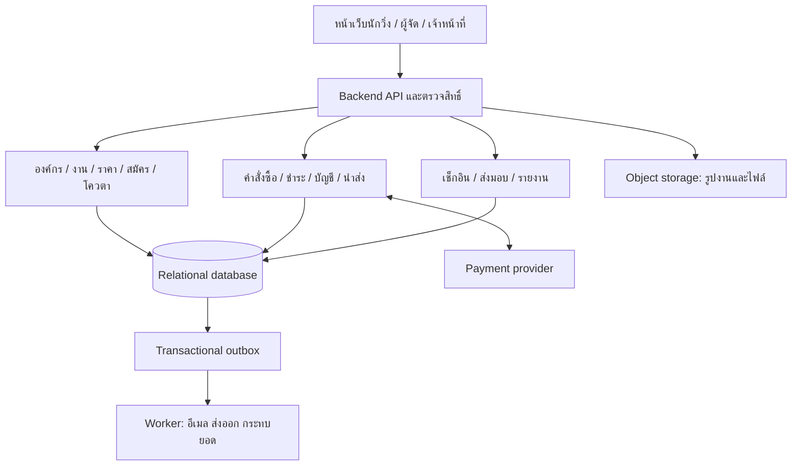

# RunEvent — Product blueprint และขอบเขต MVP

วันที่: 14 พฤศจิกายน 2026
ปรับปรุงล่าสุด: 17 พฤศจิกายน 2026 — เพิ่มแผนสินค้าและบริการผลิตตามคำขอผู้ใช้ รายละเอียดการค้าและลำดับส่งมอบยังเป็นข้อเสนอ
สถานะ: ข้อเสนอสำหรับเริ่มออกแบบรายละเอียด ยังไม่ได้เริ่มพัฒนาระบบ

## 1. การตัดสินใจที่ยืนยันแล้ว

- เป็นแพลตฟอร์มกลางสำหรับหลายผู้จัดงาน (multi-tenant B2B2C)
- ขั้นแรกคือวางระบบและขอบเขต MVP ก่อนพัฒนา
- เพิ่มการวางแผนขายเสื้อ/เหรียญที่ระลึกและบริการผลิตสำหรับผู้จัด ผู้ร่วมงาน และลูกค้าทั่วไป โดยยังไม่เริ่มพัฒนา
- นำแนวคิดด้านการบริหารงานจาก RunSignup และประสบการณ์นักวิ่ง/บริการภาพถ่ายจาก ThaiRun มาปรับใช้ ไม่คัดลอกแบรนด์หรือหน้าจอ

สมมติฐานสำหรับข้อเสนอนี้: เริ่มตลาดประเทศไทย ภาษาไทย และสกุลเงินบาท รองรับชื่อภาษาอังกฤษและนักวิ่งต่างชาติได้ในโครงสร้างข้อมูล ทั้งหมดนี้ยังปรับได้

## 2. คุณค่าของผลิตภัณฑ์

ผู้จัดเปิดรับสมัคร ตรวจเงิน และส่งมอบสิทธิ์ให้นักวิ่งได้จากข้อมูลชุดเดียว นักวิ่งค้นหางาน สมัคร ติดตามสถานะ และรับบริการหลังงานได้ผ่านบัญชีของตน

ความแตกต่างของรุ่นแรก: สมัครบนมือถือได้สะดวก ราคาสุทธิชัดเจน ผู้จัดเห็นยอดที่ตรวจสอบได้ เจ้าหน้าที่รับ BIB ได้รวดเร็ว และแยกข้อมูลแต่ละผู้จัดอย่างถูกต้อง

| แนวคิดต้นทาง | สิ่งที่นำมาใช้ | ลำดับ |
|---|---|---|
| RunSignup: ผู้จัดตั้งค่างานเอง | ตัวช่วยสร้างงาน แบบร่าง พรีวิว ตรวจความพร้อม และเผยแพร่ | MVP |
| RunSignup: กฎราคาและจำนวนรับ | ราคาตามช่วงเวลา โควตารายประเภท และโควตารวม | MVP |
| RunSignup: ระบบวันแข่ง | เช็กอินและรับ BIB จากรายชื่อเดียวกับใบสมัคร | MVP |
| RunSignup: ผู้สมัครจัดการตนเอง | ดูใบสมัครและแก้เฉพาะช่องที่ผู้จัดเปิดให้แก้ก่อนเส้นตาย | MVP |
| ThaiRun: ศูนย์รวมงานวิ่ง | ค้นหางานตามวัน จังหวัด และระยะทาง | MVP |
| ThaiRun: ภาพหลังงาน | ลิงก์อัลบั้มที่ผู้จัดตรวจสอบแล้ว | MVP แบบเล็ก |
| ThaiRun: ตลาดภาพถ่าย | อัปโหลด ค้นหา ซื้อ และแบ่งรายได้ช่างภาพ | ระยะถัดไป |
| ทั้งสอง: ความสัมพันธ์ต่อเนื่อง | ประวัติงาน บันทึกงานที่สนใจ การสื่อสารและงานประจำปี | เริ่มประวัติใน MVP |

## 3. กลุ่มผู้ใช้และสิทธิ์

- นักวิ่ง: บัญชี ข้อมูลตนเอง ใบสมัคร การจ่ายเงิน หลักฐานรับอุปกรณ์
- เจ้าขององค์กรผู้จัด: สมาชิกทีม งานทุกงาน การตั้งค่าบัญชีรับเงิน และรายงานองค์กร
- ผู้จัดการงาน: ตั้งค่าและบริหารเฉพาะงานที่ได้รับมอบหมาย
- ฝ่ายการเงิน: ดูยอด ขอคืนเงิน และตรวจรายงานตามขอบเขตที่ได้รับ
- เจ้าหน้าที่เช็กอิน: ค้นหารายชื่อและบันทึกรับอุปกรณ์ของงานที่กำหนด ไม่เห็นข้อมูลการเงินหรือข้อมูลส่วนบุคคลที่ไม่จำเป็น
- ผู้ดูแลแพลตฟอร์ม: ตรวจผู้จัด อนุมัติเผยแพร่ ระงับงาน จัดการข้อร้องเรียน และตรวจประวัติ

คนหนึ่งสังกัดหลายองค์กรได้ สิทธิ์ผูกกับสมาชิกองค์กรและขอบเขตงาน ไม่ผูกกับบทบาทเดียวบนบัญชีผู้ใช้

## 4. ขอบเขต MVP

### นักวิ่ง

- สมัครบัญชีและเข้าสู่ระบบด้วยอีเมล/รหัสผ่าน, Google หรือ LINE พร้อมยืนยันอีเมล กู้รหัสผ่าน และเชื่อมบัญชี ดูข้อ 16 (ฟีเจอร์ที่ยืนยันให้เพิ่มในแผน ยังไม่ใช่ระบบจริง)
- ค้นหางาน ดูรายละเอียดเส้นทาง ระยะ ราคา สิ่งที่จะได้รับ วันรับอุปกรณ์ และเงื่อนไข
- สมัครหนึ่งคนต่อคำสั่งซื้อในรุ่นแรก เลือกระยะและเสื้อ กรอกข้อมูลที่จำเป็น ยอมรับกติกา
- เห็นยอดรวม ค่าบริการ และค่าใช้จ่ายอื่นก่อนจ่าย
- จ่ายผ่านผู้ให้บริการชำระเงินที่เลือก ดูสถานะ ใบยืนยัน และ QR รับอุปกรณ์
- ดูประวัติใบสมัคร และแก้ข้อมูลตามนโยบายงาน
- เข้าถึงผลการแข่งขันหรืออัลบั้มผ่านลิงก์ที่ผู้จัดประกาศ

### ผู้จัดงาน

- สมัครองค์กร เพิ่มทีม ส่งข้อมูลตรวจสอบผู้จัดและบัญชีรับเงิน
- สร้างงานแบบร่าง ตั้งวัน สถานที่ ระยะ โควตา ราคา เสื้อ และนโยบาย
- พรีวิว ส่งตรวจ และเปิดรับสมัครหลังผ่านเงื่อนไขความพร้อม
- ดูและส่งออกรายชื่อ แยกยอดชำระ ยอดรอดำเนินการ และยอดคืน
- กำหนดหรือ import BIB แบบตรวจเลขซ้ำในขอบเขตงาน
- ดูสรุปเสื้อแต่ละขนาดและบันทึกส่งมอบอุปกรณ์
- เช็กอินผ่านเว็บบนมือถือด้วย QR หรือค้นหาที่ควบคุมสิทธิ์
- ส่งอีเมลสำคัญ เช่น ยืนยันสมัคร แจ้งรายละเอียดวันงาน และแจ้งยกเลิก
- ขอคืนเงินพร้อมเหตุผลตามขั้นตอนที่กำหนด
- ดูรายการยอดนำส่งและรายการที่ยังตรวจสอบไม่จบ
- ส่วนขยายที่เสนอ: ร้านค้าของงาน โปรโมทสินค้า พรีออเดอร์ และขอราคาผลิตกับ RunEvent ดูรายละเอียดข้อ 15; ยังต้องยืนยันการรวมใน MVP รุ่นแรก

### ผู้ดูแลแพลตฟอร์ม

- ตรวจองค์กรและการตั้งค่ารับเงินก่อนเปิดขาย
- ตรวจงานก่อนเผยแพร่ในช่วง MVP
- จัดการเรื่องร้องเรียนและข้อยกเว้น พร้อมประวัติผู้ดำเนินการ
- ตรวจธุรกรรม ยอดนำส่ง และการคืนเงิน
- ระงับงาน/องค์กรโดยไม่ลบหลักฐานการเงินและใบสมัครย้อนหลัง

### ยังไม่รวมใน MVP

- ตลาดขายภาพ ระบบค้นหาใบหน้า และแบ่งเงินช่างภาพ
- ระบบจับเวลาจากชิป GPS tracking และผลการแข่งขันสด
- Virtual Run และการเชื่อมอุปกรณ์สุขภาพ
- fundraising, สมาชิกชมรม, loyalty, referral และแคมเปญอีเมลขั้นสูง
- สมัครกลุ่ม relay ย้ายสิทธิ์ข้ามคน เลื่อนสิทธิ์ข้ามปี และ waitlist อัตโนมัติ
- แอป native, marketplace สินค้าทั่วไป และ AI chatbot
- marketplace สินค้าทั่วไปในที่นี้หมายถึงตลาดหลายร้านแบบเต็มรูปแบบ ไม่รวมข้อเสนอร้านค้าเฉพาะงานในข้อ 15 ซึ่งลูกค้าซื้อได้โดยไม่สมัครวิ่ง
- เช็กอินออฟไลน์อัตโนมัติ: รุ่นแรกใช้ระบบออนไลน์พร้อมรายชื่อสำรองและขั้นตอนกระทบยอด

## 5. Workflow

### เปิดงาน

สร้างองค์กร → ตรวจผู้จัด/บัญชีรับเงิน → สร้างงาน → ตั้งราคา/โควตา/นโยบาย → พรีวิว → ตรวจความพร้อม → อนุมัติเผยแพร่ → เปิดรับสมัคร

### สมัคร

เลือกงาน → ตรวจคุณสมบัติ → เลือกระยะ/เสื้อ → กรอกข้อมูล → ยอมรับนโยบายฉบับที่ใช้ → คำนวณยอดฝั่งเซิร์ฟเวอร์ → กันโควตาชั่วคราว → สร้างรายการชำระ → รับผลที่ตรวจสอบแล้ว → ยืนยันสิทธิ์ → ส่งใบยืนยัน

### วันงาน

เตรียม BIB/เสื้อ → สแกน QR → ตรวจสิทธิ์และรายการส่งมอบ → เจ้าหน้าที่กดยืนยันรับ → บันทึกผู้ทำรายการและเวลา → ป้องกันรับซ้ำ

### ปิดงาน

ประกาศผล/อัลบั้ม → แก้ข้อยกเว้น → กระทบยอดธุรกรรม/คืนเงิน/นำส่ง → ปิดรายงาน → ทำสำเนางานครั้งต่อไปโดยไม่คัดลอกข้อมูลส่วนบุคคลของผู้สมัครโดยอัตโนมัติ

## 6. กฎธุรกิจสำคัญ

1. Tenant isolation: ทุกคำขอของผู้จัดต้องตรวจสมาชิกองค์กรและสิทธิ์งานบนเซิร์ฟเวอร์ ไม่เชื่อ organization_id จากหน้าเว็บอย่างเดียว
2. การเผยแพร่: ต้องมีวัน สถานที่ ประเภท ราคา โควตา นโยบาย ช่องทางติดต่อ และบัญชีรับเงินพร้อมใช้งาน
3. เวลา: เก็บเวลามาตรฐานและ timezone ของงาน ใช้ Asia/Bangkok เป็นค่าเริ่มต้นตามสมมติฐานตลาดไทย
4. ราคา: เซิร์ฟเวอร์คำนวณและบันทึก snapshot ยอดรวม/ส่วนลด/ค่าบริการของคำสั่งซื้อ กำหนดให้ช่วงราคาไม่ซ้อนกัน
5. โควตา: กันประเภทวิ่ง โควตารวม และเสื้อแบบ atomic ไม่ขายเกินเมื่อมีคนสมัครพร้อมกัน อายุการกันต้องสัมพันธ์กับ payment provider
6. สมัครซ้ำ: ตรวจผู้เข้าร่วมเดียวกันในประเภทเดียวกันตามนโยบาย ไม่บังคับเก็บเลขบัตรประชาชนเพียงเพื่อใช้เป็น unique key
7. Payment: ไม่ถือว่าหน้ากลับจาก payment gateway คือหลักฐานจ่ายสำเร็จ ต้องตรวจ webhook หรือสอบถามสถานะจาก provider
8. Idempotency: webhook ซ้ำต้องไม่ยืนยันซ้ำ ตัดโควตาซ้ำ หรือสร้างรายการเงินซ้ำ
9. การจ่ายล่าช้า: ถ้าโควตาหมดอายุแล้วแต่รับเงินสำเร็จ ต้องพักรายการไว้ตรวจสอบ ยืนยันได้เมื่อจัดสรรโควตาใหม่สำเร็จ มิฉะนั้นเข้าสู่กระบวนการคืนเงิน ห้ามยืนยันจนเกินโควตา
10. คืนเงิน: ใช้สถานะแยกจากใบสมัครและการชำระ อนุญาตในขอบเขตวงเงินที่จ่ายจริง และบันทึกเหตุผล ไม่คืนโควตาอัตโนมัติโดยไม่มีนโยบาย
11. แก้ข้อมูล: ผู้จัดกำหนดช่องและเส้นตาย ค่าใช้จ่ายหรือโควตาที่เปลี่ยนต้องผ่าน workflow เฉพาะ ไม่แก้ยอดย้อนหลังทับของเดิม
12. เช็กอิน: QR เป็น token ที่คาดเดายาก ไม่ใส่ข้อมูลอ่อนไหว เจ้าหน้าที่ต้องล็อกอิน การสแกนเพียงอย่างเดียวยังไม่ถือว่าส่งมอบแล้ว
13. รับอุปกรณ์: แยก check-in จากการรับ BIB/เสื้อ เผื่อมารับก่อนวันแข่ง การยกเลิกการรับต้องมีสิทธิ์และเหตุผล
14. นโยบาย: บันทึกฉบับนโยบายที่ยอมรับ เวลา และผู้ดำเนินการ แยกการยินยอมการตลาดออกจากเงื่อนไขเข้าร่วม
15. รายงาน: ยอดสมัคร ยอดรับเงิน รายได้แพลตฟอร์ม และยอดนำส่งผู้จัดเป็นคนละค่า ต้องติดตามได้ระดับรายการ

## 7. สถานะและแบบจำลองข้อมูล

สถานะไม่ควรรวมไว้ใน field เดียว:

- Event: draft → in_review → published → closed → completed; มี suspended/cancelled เป็นทางแยก
- Registration: pending_payment → confirmed → cancelled; expired สำหรับรายการที่ไม่ได้สิทธิ์
- Payment: pending → succeeded / failed / expired; ติดตาม refunded amount แยก
- Refund: requested → approved → processing → succeeded / failed / rejected
- Payout: scheduled → processing → paid / failed / held
- CheckIn และ Fulfillment: เป็นรายการเหตุการณ์ที่ตรวจการรับซ้ำและตรวจย้อนกลับได้

Entity หลัก:

| กลุ่ม | Entity |
|---|---|
| ตัวตนและองค์กร | User, Organization, OrganizationMembership, EventPermission |
| งานและสินค้า | Event, RaceCategory, PriceTier, InventoryOption, PolicyVersion |
| สมัคร | ParticipantProfile, Registration, InventoryReservation, PolicyAcceptance |
| เงิน | Order, OrderLine, PaymentAttempt, ProviderEvent, Refund, LedgerEntry, Payout |
| ปฏิบัติการ | BibAssignment, CheckIn, Fulfillment, Notification, AuditLog |

ผู้ซื้อกับผู้เข้าร่วมแยกแนวคิดตั้งแต่แรก แม้ UI รุ่นแรกสมัครทีละคน เพื่อไม่ต้องรื้อข้อมูลเมื่อต้องรองรับผู้ปกครองหรือสมัครกลุ่มภายหลัง

## 8. Architecture ที่เสนอ

เริ่มด้วย modular monolith: แอปหลักแยกโมดูลชัดเจน ใช้ฐานข้อมูลเชิงสัมพันธ์ร่วมกัน และมี background worker สำหรับงานเบื้องหลัง ไม่จำเป็นต้องเริ่มด้วย microservices

- ใช้ transaction และ constraints คุมโควตา BIB และรายการเงิน
- ใช้ outbox/คิวส่งอีเมลหลังยืนยันธุรกรรมสำเร็จ ป้องกันส่งแจ้งเตือนสำหรับธุรกรรมที่ rollback
- เก็บยอดเงินเป็นหน่วยย่อยจำนวนเต็มและระบุสกุลเงิน
- เก็บบัญชีรายการเงินแบบตรวจย้อนหลังได้ ไม่คำนวณยอดนำส่งจากยอดใบสมัครปัจจุบันเพียงอย่างเดียว
- แยกข้อมูลธุรกรรมออกจาก analytics; analytics ใช้สรุปแนวโน้ม ไม่ใช้ตัดสินว่าใครจ่ายแล้ว
- กำหนด retention, export ที่จำกัดสิทธิ์, signed download links และการเข้าถึงข้อมูลฉุกเฉิน
- มี structured logs, error monitoring, backup และทดสอบกู้คืน
- ยังไม่ล็อก framework, cloud หรือ payment provider จนกว่าจะทราบข้อจำกัดทีมและการรับเงิน

## 9. เงินและโมเดลธุรกิจ

ข้อเสนอเริ่มต้น: ค่าบริการตามการสมัครที่ชำระสำเร็จ โดยเลือกให้นักวิ่งหรือผู้จัดเป็นผู้รับภาระได้ แสดงยอดชัดเจนก่อนชำระ ยังไม่กำหนดอัตราเพราะต้องรู้ต้นทุน provider, support และความเสี่ยงคืนเงินก่อน

แยกยอด:

- มูลค่าธุรกรรมรวม: เงินที่ขายได้ผ่านระบบ ไม่ใช่รายได้บริษัท
- รายได้แพลตฟอร์ม: ค่าบริการที่มีสิทธิ์รับตามสัญญา
- เงินผู้จัด: ภาระที่ต้องนำส่งหลังหักรายการตามข้อตกลง
- ต้นทุน: gateway, hosting, support และรายการที่ต้องรับภาระจริง

ควรตรวจความพร้อมของ provider สำหรับ marketplace/sub-merchant ก่อนกำหนดรูปแบบรับและนำส่งเงิน ไม่สมมติว่าระบบจะรับเงินทั้งหมดเข้าบัญชีแพลตฟอร์มแล้วโอนต่อได้ทันที ขอบเขตภาษี เอกสารบัญชี และสัญญาต้องตกลงกับผู้ให้บริการและผู้เชี่ยวชาญก่อนเปิดขายจริง

## 10. Acceptance criteria ก่อน pilot

- องค์กร A ไม่สามารถอ่าน แก้ ส่งออก หรือเช็กอินข้อมูลขององค์กร B ได้
- เปิดรับสมัครได้ครบวงจรตั้งแต่ draft ถึงยืนยันสิทธิ์และส่งอีเมล
- ทดสอบแย่งโควตาสุดท้ายพร้อมกันแล้วไม่ขายเกิน รวมโควตาเสื้อ
- webhook ซ้ำ ผิดลำดับ จ่ายหลังหมดเวลา และ network timeout ไม่สร้างสิทธิ์หรือยอดซ้ำ
- คำสั่งซื้อแต่ละรายการตามกลับไปยัง payment, refund และ payout ได้
- เช็กอินซ้ำจากสองอุปกรณ์ต้องมีผู้ยืนยันสำเร็จได้เพียงครั้งเดียว
- ส่งออกยอดเสื้อ BIB และผู้มีสิทธิ์ตรงกับข้อมูลจริง
- บทบาทการเงินและเช็กอินเข้าถึงเฉพาะข้อมูลที่ต้องใช้
- ทดสอบ restore backup และขั้นตอนทำงานเมื่อบริการชำระเงินหรืออีเมลขัดข้อง
- ทดสอบบนมือถือกับผู้จัดและนักวิ่งจริงก่อนเปิด pilot

## 11. ลำดับส่งมอบ

1. ยืนยันนโยบายเงิน นโยบายสมัคร ขอบเขตผู้เข้าร่วม และเกณฑ์ pilot
2. ออกแบบ user journey, wireframe และต้นแบบสำหรับ flow หลัก
3. วาง schema, permission matrix, API contract และ state transitions
4. พัฒนา vertical slice: ผู้จัดสร้างงาน → นักวิ่งจ่ายใน sandbox → ยืนยัน → เช็กอิน
5. เติมรายงาน เงินคืน การนำส่ง การส่งออก และการดูแลระบบ
6. ทดสอบความถูกต้องและโหลดตามขนาด pilot ที่ตกลง แล้วทดลองกับผู้จัดกลุ่มเล็ก

ไม่กำหนดวันส่งมอบจนกว่าจะทราบทีม งบ ขนาดงาน และ provider

## 12. เรื่องที่ต้องตัดสินใจก่อนพัฒนา

- ไทย/THB เป็นตลาดแรกตามสมมติฐานหรือไม่
- ขนาด pilot: จำนวนผู้จัด จำนวนผู้สมัครต่ออีเวนต์ และการเปิดขายพร้อมกัน
- ผู้รับเงินตามสัญญา ผู้รับภาระค่าบริการ รอบนำส่ง และการคืนเงิน
- ผู้ให้บริการชำระเงินและช่องทางที่ต้องรองรับจริง
- นโยบายผู้เยาว์ สมัครแทน และข้อมูลจำเป็น เช่น เสื้อหรือผู้ติดต่อฉุกเฉิน
- ผู้รับผิดชอบ support ก่อนงานและวันงาน
- ทีมพัฒนา งบประมาณ โฮสติ้ง และข้อจำกัดเทคโนโลยี

## 13. ตัวชี้วัด

- เวลาที่ผู้จัดใช้จนเปิดรับสมัครสำเร็จ
- อัตราเริ่มสมัครจนได้สิทธิ์ และอัตราจ่ายสำเร็จ
- ความคลาดเคลื่อนของเงิน โควตา และรายการส่งมอบ
- เวลาต่อการเช็กอิน และจำนวนคำขอช่วยเหลือต่อ 100 ใบสมัคร
- รายได้ค่าบริการสุทธิหลังต้นทุนผันแปร
- จำนวนผู้จัดที่กลับมาเปิดงาน และนักวิ่งที่กลับมาสมัคร

## 14. แหล่งอ้างอิงและขอบเขตข้อสรุป

รายละเอียดฟีเจอร์บัญชีที่เพิ่มภายหลังอยู่ในข้อ 16 พร้อมแหล่งอ้างอิงเฉพาะด้าน

ข้อมูลคู่แข่งจากการศึกษาวันที่ 14 พฤศจิกายน 2026 ส่วนขอบเขตและ architecture ในเอกสารนี้เป็นข้อเสนอของ RunEvent ไม่ใช่ระบบภายในของคู่แข่ง

- RunSignup products: https://info.runsignup.com/
- Registration: https://info.runsignup.com/products/race-registration/
- Pricing: https://info.runsignup.com/pricing/
- Strategy: https://info.runsignup.com/2025/10/29/2026-company-strategy/
- Infrastructure: https://info.runsignup.com/2025/11/28/2025-thanksgiving-and-year-infrastructure-report/
- ThaiRun products: https://www.thai.run/
- ThaiRun photo business explanation (2023; ไม่ใช่อัตราปัจจุบันที่ยืนยันแล้ว): https://read.thai.run/139/

## 15. สินค้า การโปรโมท และบริการผลิต

เพิ่มวันที่ 17 พฤศจิกายน 2026 ตามคำขอให้บันทึกแนวคิดลงแผน โครงสร้างด้านล่างเป็นข้อเสนอ ไม่ได้ยืนยันราคา จำนวนขั้นต่ำ ผู้ผลิต หรือสัญญาบริการ และไม่เปลี่ยนคำสั่งให้วางแผนก่อนลงโค้ด

### 15.1 ลูกค้าและจุดเชื่อมกับงานวิ่ง

| กลุ่ม | จุดใช้งาน | บริการ |
|---|---|---|
| ผู้จัดงาน | เตรียมงานและสรุปยอดก่อนผลิต | ซื้อจำนวนมาก ขอออกแบบ ผลิตเสื้อ/เหรียญ และติดตามส่งมอบ |
| ผู้สมัครงาน | ก่อนสรุปยอดสมัคร | ซื้อสินค้าเพิ่มจากแพ็กเกจสมัคร |
| ผู้สมัครเดิม | ใบสมัครของฉัน | สร้างคำสั่งซื้อสินค้าใหม่ เชื่อมใบสมัครเดิม |
| ลูกค้าทั่วไป | หน้าร้านของงาน | ซื้อสินค้าพร้อมขายหรือพรีออเดอร์โดยไม่ต้องสมัครวิ่ง |
| ชมรม ทีม บริษัท | หน้าบริการสั่งทำ | ส่งแบบ/ความต้องการ ขอราคา และติดตามการผลิต ไม่จำเป็นต้องมีงานวิ่ง |

### 15.2 รูปแบบบริการสำหรับผู้จัด

1. **นำสินค้ามาขายเอง:** ผู้จัดมีสินค้าและส่งมอบเอง RunEvent ให้หน้าร้าน การโปรโมท คำสั่งซื้อ และรายงาน
2. **ให้ RunEvent ผลิต:** ผู้จัดส่งแบบหรือขอช่วยออกแบบ รับใบเสนอราคา อนุมัติตัวอย่าง และรับสินค้าจำนวนมาก
3. **ให้ RunEvent ดูแลครบ:** รวมเปิดพรีออเดอร์ ผลิต แพ็ก และจัดส่งถึงผู้ซื้อหรือเตรียมรับหน้างาน ตามข้อตกลง

ต้องระบุผู้ขาย ผู้รับเงิน ผู้ผลิต และผู้รับผิดชอบส่งมอบให้ชัดในแต่ละรายการ ไม่ถือว่า RunEvent เป็นผู้ขายหรือผู้ผลิตในทุกกรณีโดยอัตโนมัติ ผู้จัดยังเลือกนำสินค้าที่ผลิตเองมาขายได้

### 15.3 การโปรโมทและเปลี่ยนความสนใจเป็นคำสั่งผลิต

- หน้าร้านเฉพาะงาน พร้อมภาพ รายละเอียด ตารางไซซ์ สถานะสินค้า และลิงก์แชร์
- เชื่อมสินค้าในหน้างาน ขั้นตอนสมัคร และใบสมัครเดิม โดยไม่บังคับซื้อเพิ่ม
- ตอนสร้างงานให้เลือกขอความช่วยเหลือเรื่องเสื้อ/เหรียญ
- ตอนเพิ่มสินค้าให้เลือกใช้สินค้าของตนหรือขอราคาผลิตกับ RunEvent
- รายงานสรุปไซซ์และยอดต้องใช้ มีทางสร้างคำขอราคาจากยอดนั้น
- แจ้งเตือนวันปิดพรีออเดอร์ ส่งแบบ ยืนยันจำนวน และกำหนดรับสินค้า
- งานปีถัดไปนำแบบและข้อมูลยอดรวมมาช่วยประมาณการได้ โดยไม่คัดลอกข้อมูลส่วนบุคคลโดยไม่จำเป็น
- ข้อเสนอเชิงพาณิชย์ที่ต้องคำนวณก่อนใช้: ราคาตามจำนวน บริการตัวอย่าง/ช่วยออกแบบ สิทธิประโยชน์ค่าหน้าร้านหรือค่าบริการเมื่อสั่งผลิต
- ไม่สัญญายอดขาย การเข้าถึง ระยะผลิต หรือส่วนลดที่ยังไม่ได้รับการยืนยันจากต้นทุนและผู้ผลิต

### 15.4 Workflow

**ผู้จัดสั่งผลิต:** ประมาณการจำนวน → ส่งความต้องการ/แบบ → ขอราคา → ตรวจตัวอย่างและอนุมัติแบบ/ราคา → ยืนยันจำนวนและไซซ์ → ชำระตามข้อตกลง → ผลิต → ตรวจคุณภาพ → จัดส่ง → ตรวจรับ/แจ้งปัญหา

**ซื้อพร้อมสมัคร:** เลือกระยะ → เลือกสิทธิ์ที่รวมในแพ็กเกจ → เลือกซื้อเพิ่ม → รับหน้างาน/จัดส่ง → แสดงราคาแยกรายการ → ชำระ → ยืนยันใบสมัครและรายการสินค้าตามผลธุรกรรม

**ซื้อภายหลังหรือซื้อทั่วไป:** เปิดร้าน/ใบสมัคร → เลือกสินค้าและไซซ์ → เลือกส่งมอบ → สร้างคำสั่งซื้อใหม่ → ชำระ → ติดตามสินค้า โดยการซื้อทั่วไปไม่สร้างสิทธิ์เข้าร่วมการแข่งขัน

**พรีออเดอร์:** ประกาศเงื่อนไขและวันปิด → รวบรวมคำสั่งซื้อ → ตรวจยอดตามฐานที่ระบุ → สรุปยอดผลิต → อนุมัติผลิต → ส่งมอบ หากไม่ถึงขั้นต่ำให้ใช้ทางเลือกที่ประกาศ เช่น ยกเลิกและคืนเงิน ไม่ถือว่าคำสั่งซื้อรับประกันว่าจะเริ่มผลิตทันที

### 15.5 กฎสินค้าและสิทธิ์

- เสื้อรวมค่าสมัครเป็นสิทธิ์แพ็กเกจ เสื้อซื้อเพิ่มเป็นรายการขาย มีราคาและจำนวนแยกกัน
- เหรียญ Finisher ผูกกับกติกาจบการแข่งขัน เหรียญที่ระลึกเป็นสินค้า รางวัลผู้ชนะผูกกับผล/อันดับ การซื้อไม่ทำให้ได้สถานะ Finisher หรือผู้ชนะ
- สินค้าต้องแยก SKU/variant เช่น แบบ สี ไซซ์ วัสดุ พร้อมสต็อกหรือเพดานพรีออเดอร์ การใช้สินค้าร่วมกันระหว่างแพ็กเกจกับร้านต้องจัดสรรจากแหล่งเดียวกันเพื่อไม่ขายเกิน
- ยอดต้องผลิตต้องแยกของตามสิทธิ์ สินค้าซื้อเพิ่ม และจำนวนสำรองที่ผู้จัดกำหนด หักสินค้าที่มีและรายการจัดซื้อเดิมอย่างมีหลักฐาน ไม่รวมซ้ำหรือเดาจำนวนสำรอง
- เก็บยอดและเวอร์ชันแบบ ณ วันอนุมัติผลิต การเปลี่ยนหลังอนุมัติต้องแจ้งผลต่อราคา/เวลาและบันทึกการยอมรับใหม่
- หน้าสินค้าแสดงผู้ขาย ราคา ไซซ์ พร้อมส่ง/พรีออเดอร์ ขั้นต่ำถ้ามี วันปิด วันที่คาดส่ง ค่าส่ง และเงื่อนไขกรณียอดไม่ถึง/คืน/เปลี่ยน/ชำรุด
- รายการซื้อหลังสมัครเป็นคำสั่งซื้อใหม่ การคืนสินค้าไม่ยกเลิกสิทธิ์สมัครโดยอัตโนมัติ และการยกเลิกงานไม่คืนสินค้าทุกรายการโดยอัตโนมัติ ต้องกำหนดนโยบายแยก
- เงินค่าสมัคร ค่าขายสินค้า ค่าบริการ ค่าส่ง และเงินจัดซื้อ/ผลิตแยกรายการให้กระทบยอดได้ หากมีมัดจำให้ติดตามยอดครบกำหนดและยอดคงเหลือแยกจากสถานะผลิต
- รุ่นแรกเสนอให้หนึ่งคำสั่งซื้อสินค้ามีผู้ขายหนึ่งราย ไม่เริ่มตะกร้าหลายผู้ขายจนกว่ากติกานำส่ง/คืนเงินชัด
- การส่งมอบติดตามระดับรายการและจำนวน รองรับแยกส่งหรือรับบางส่วน ป้องกันส่ง/รับซ้ำ ไม่ใช้ check-in คนเดียวแทนการรับสินค้าทั้งหมด
- การรับสินค้าโดยผู้ไม่สมัครวิ่งใช้หลักฐานคำสั่งซื้อ ไม่ต้องมี BIB และไม่ทำให้เกิด race check-in
- คำขอผลิตไม่ใช่คำสั่งให้โรงงานเริ่มงาน จนกว่าจะผ่านการยืนยันแบบ ราคา จำนวน และเงื่อนไขชำระที่ตกลง
- ผู้จัด/ผู้สั่งทำยืนยันสิทธิ์ใช้แบบหรือโลโก้ก่อนเผยแพร่และผลิต กำหนดขอบเขตเข้าถึงไฟล์แบบและข้อมูลจัดส่งตามบทบาท

### 15.6 ข้อมูลและสถานะที่เสนอเพิ่ม

| กลุ่ม | แนวคิดข้อมูล |
|---|---|
| ร้านค้า | Storefront, Product, ProductVariant, Seller |
| สินค้าคงคลัง | StockMovement, StockReservation, PreorderCampaign |
| สั่งทำ | ProductionInquiry, Quote, ArtworkVersion, ArtworkApproval, ProductionOrder |
| ส่งมอบ | Shipment, FulfillmentLine, GoodsReceipt |

ใช้ Order/OrderLine, Payment, Refund และ Ledger เดิมร่วมเมื่อเหมาะสม โดยแยกประเภทและคู่สัญญา ไม่สร้างชุดยอดเงินที่ขัดกัน สถานะชำระ ผลิต และส่งมอบแยกจากกัน

- คำขอราคา: ร่าง → ส่งคำขอ → รอข้อมูล/เสนอราคา → ยอมรับ/ปฏิเสธ/หมดอายุ
- งานผลิต: รอยืนยันเงื่อนไข → พร้อมผลิต → ผลิต → ตรวจคุณภาพ → พร้อมส่ง → ปิดงาน; มีทางพัก/แก้ไข/ยกเลิกตามเงื่อนไข
- สินค้าส่งมอบ: ยังไม่จัดสรร → เตรียมของ → พร้อมรับ/ส่งแล้ว → รับบางส่วน/ครบ → ปัญหา/ส่งคืน

### 15.7 ลำดับที่เสนอและเรื่องต้องตัดสินใจ

เริ่มจากร้านค้าเฉพาะงาน ลิงก์โปรโมท สินค้าพร้อมขาย/พรีออเดอร์ ซื้อเพิ่ม และแบบฟอร์มขอราคาผลิต โดยทีม RunEvent ประสานใบเสนอราคาและโรงงานหลังบ้านก่อน ยังไม่ทำ marketplace ผู้ผลิตหรือระบบโรงงานอัตโนมัติ

ต้องยืนยันก่อนรวมในรุ่นส่งมอบ: ผู้ขายและผู้รับเงินแต่ละโมเดล ต้นทุน/ค่าบริการ ผู้ผลิตและขั้นต่ำ รอบชำระ ระยะผลิต ตัวอย่าง/อนุมัติแบบ การส่งมอบ ภาษี/เอกสารตามผู้ขาย และนโยบายคืน/ยกเลิก/ชำรุด

ตัวชี้วัดที่เสนอ: ผู้จัดที่เปิดร้านและขอราคา อัตรายอมรับใบเสนอราคา ยอดสั่งผลิต มูลค่าขายสินค้า กำไรหลังต้นทุนผันแปร การส่งตรงเวลา และอัตราปัญหาสินค้า ทุกตัวต้องนิยามฐานเวลาและแยกยอดขายออกจากรายได้แพลตฟอร์ม

## 16. บัญชีและการเข้าสู่ระบบ

เพิ่มวันที่ 17 พฤศจิกายน 2026: ผู้ใช้ยืนยันให้เพิ่มฟีเจอร์อีเมล/รหัสผ่าน, Google และ LINE ลงในแผน รายละเอียดด้าน implementation ยังต้องออกแบบก่อนพัฒนา ระบบปัจจุบันเป็น Login จำลองเท่านั้น

### 16.1 ขอบเขตและ flow

- หน้าเข้าสู่ระบบมีอีเมล/รหัสผ่าน แสดงหรือซ่อนรหัสผ่าน ลืมรหัสผ่าน สมัครใหม่ และปุ่ม Google/LINE
- สมัครเอง: กรอกชื่อ อีเมล รหัสผ่าน ยอมรับข้อกำหนด แล้วใช้ลิงก์ยืนยันอีเมลก่อนเปิดใช้งานบัญชีตามนโยบาย
- Google/LINE: ยืนยันกับ provider แล้วตรวจผลที่ backend หากเป็นผู้ใช้เดิมเปิด session หากเป็นผู้ใช้ใหม่ให้ตรวจชื่อ ช่องทางติดต่อ และยอมรับข้อกำหนดก่อนสร้างบัญชี
- LINE ไม่มีอีเมลยังสร้างบัญชีจากตัวตน provider ได้ ให้เพิ่มและยืนยันอีเมลก่อนใช้ฟังก์ชันที่ต้องใช้อีเมล ไม่สร้างอีเมลสมมติแทน
- แยกอีเมลจาก provider ออกจากช่องทางติดต่อที่ผู้ใช้เพิ่ม/แก้ สถานะการยืนยันต้องมีหลักฐานตาม flow นั้น
- เก็บข้อมูลสมัครเริ่มต้นเท่าที่จำเป็น ชื่อใน social profile ไม่ใช่ชื่อแข่งขันที่ยืนยันแล้ว ข้อมูลเสื้อ วันเกิด และฉุกเฉินขอตามงานที่ใช้
- อ่านงานและดูสินค้าได้ก่อน Login กลับไปทำรายการเดิมหลังยืนยันตัวตน โดยรับเฉพาะปลายทางกลับที่ระบบอนุญาต ป้องกัน open redirect
- แยกความยินยอมการตลาดออกจากการยอมรับข้อกำหนดและบันทึกเวอร์ชัน

### 16.2 บัญชีเดียวและสิทธิ์องค์กร

- User หนึ่งรายการเชื่อมวิธีเข้าสู่ระบบได้หลายวิธี ใช้ข้อมูลใบสมัคร คำสั่งซื้อ และสมาชิกองค์กรชุดเดียวกัน
- ใช้ตัวระบุ provider ที่ตรวจสอบแล้ว เช่น issuer + sub ในบริบท channel/provider ที่ตั้งค่า ไม่ใช้อีเมลหรือชื่อแสดงผลเป็นตัวเชื่อมหลัก
- Login เป็นการพิสูจน์ตัวตน สิทธิ์งานต้องมาจาก OrganizationMembership และการมอบหมาย ไม่มาจากข้อมูลที่ผู้ใช้เลือกบนหน้า Login
- หลัง Login ให้กลับรายการเดิมหรือองค์กรล่าสุดที่ยังมีสิทธิ์ หากมีหลายองค์กรให้เลือกได้
- สมัครเป็นผู้จัดด้วยบัญชีเดิมและสร้างองค์กรรอตรวจ การเปิดขายขึ้นกับการตรวจผู้จัด/บัญชีรับเงิน
- คำเชิญทีมมีบทบาท ขอบเขต อายุ และการใช้ครั้งเดียว ตรวจบัญชีผู้รับตามนโยบายก่อนเพิ่มสมาชิก ไม่อาศัยการมีลิงก์อย่างเดียวเพื่อให้สิทธิ์สำคัญ

### 16.3 เชื่อมบัญชีและจัดการบัญชีซ้ำ

- ผู้ใช้ที่ Login อยู่เชื่อม Google/LINE เพิ่มได้หลังยืนยันตัวตนใหม่และยืนยันกับ provider ที่จะเพิ่ม
- ผู้สมัครผ่าน social เพิ่มอีเมลที่ยืนยันแล้วและตั้งรหัสผ่านได้ เพื่อเข้าสู่บัญชีเดิม
- หากอีเมลตรงบัญชีเดิม ให้ยืนยันความเป็นเจ้าของบัญชีเดิมก่อนเชื่อม ไม่รวมอัตโนมัติ
- หาก provider identity ผูกกับ User อื่นแล้ว ให้หยุดการเชื่อมและใช้ขั้นตอนแก้บัญชีซ้ำที่พิสูจน์ทั้งสองบัญชี ห้ามย้ายประวัติ เงิน หรือสิทธิ์องค์กรเงียบ ๆ
- ห้ามถอดช่องทางสุดท้ายที่ใช้เข้าสู่ระบบได้ จนกว่าจะเพิ่มและยืนยันช่องทางทดแทน
- บัญชีและความปลอดภัยรวมการเปลี่ยนอีเมล/รหัสผ่าน วิธีเข้าสู่ระบบ และ session อุปกรณ์ พร้อมออกจากระบบอุปกรณ์อื่น

### 16.4 ข้อมูลและข้อกำหนดระบบจริง

แนวคิดข้อมูล: User, AuthIdentity, PasswordCredential, ContactVerification, Session, PasswordResetToken, Invitation และ ConsentAcceptance เชื่อม OrganizationMembership เดิม ไม่เพิ่มบทบาทที่เชื่อถือจาก frontend

- ใช้ password hash ที่เหมาะสม ไม่เก็บรหัสผ่าน plaintext หรือบันทึกลง logs
- ลิงก์ยืนยันอีเมล/รีเซ็ตรหัสผ่านมีอายุ ใช้ครั้งเดียว และจัดเก็บ token อย่างปลอดภัย
- จำกัดความถี่ Login, reset และ resend ตอบแบบไม่เปิดเผยว่าบัญชีอีเมลมีอยู่หรือไม่
- ตรวจ provider token ฝั่ง backend รวมลายเซ็น issuer audience อายุ และ nonce; ตรวจ state และใช้ PKCE ตาม flow มาตรฐานที่เลือก
- จัดการ session ฝั่งเซิร์ฟเวอร์และ cookie HttpOnly/Secure ในระบบจริง พร้อมการป้องกัน CSRF ที่เหมาะสม ไม่ใช้ localStorage mock เป็นหลักฐานสิทธิ์
- ไม่ใส่ client secret ใน frontend/repository และไม่ขอสิทธิ์ provider เกินจำเป็น
- การเปลี่ยนอีเมล รหัสผ่าน หรือการเชื่อม/ถอดวิธี Login ต้องยืนยันตัวตนใหม่ แจ้งการเปลี่ยนแปลง และกำหนดการเพิกถอน session ที่เกี่ยวข้อง
- ทดสอบบัญชีถูกระงับ provider ยกเลิก consent, callback หมดอายุ และ recovery เมื่อเข้า provider เดิมไม่ได้
- แยกปุ่ม/บัญชีสาธิตและข้อมูลสาธิตจากระบบจริงชัดเจน

### 16.5 เกณฑ์ยอมรับและเรื่องต้องตัดสินใจ

ต้องทดสอบผู้ใช้ใหม่/เดิมทั้งสามวิธี อีเมลไม่ยืนยัน LINE ไม่มีอีเมล provider identity ซ้ำ อีเมลตรงแต่คนละบัญชี ลิงก์หมดอายุ/ใช้ซ้ำ ยกเลิก Login กลับหน้ารายการเดิม องค์กรไม่มีสิทธิ์ คำเชิญใช้ซ้ำ และเพิกถอน session

ยังต้องเลือก auth stack, provider app/channel, callback URLs ของแต่ละ environment, ผู้ส่งอีเมล, อายุ session/token, นโยบาย recovery/บัญชีซ้ำ และการยืนยันเพิ่มเติมสำหรับบทบาทสำคัญก่อนพัฒนาระบบจริง

แหล่งอ้างอิงจากการศึกษาวันที่ 17 พฤศจิกายน 2026 (ตรวจเงื่อนไขปัจจุบันอีกครั้งตอน implementation):

- [Google OpenID Connect](https://developers.google.com/identity/openid-connect/openid-connect)
- [LINE Login สำหรับเว็บและสิทธิ์อีเมล](https://developers.line.biz/en/docs/line-login/web/integrate-line-login/)
- [LINE PKCE](https://developers.line.biz/en/docs/line-login/integrate-pkce/)

